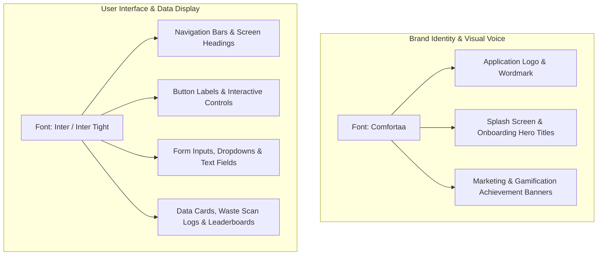

# EBasura Brand Identity & Design System Specification

> **Document Status**: Canonical Design Specification  
> **Backlog Reference**: `[EBASURA-M0-F1]` (FlutterFlow Core Engine & Theme Provider) / `[EBASURA-M10-F2]` (Shared UI Components)  
> **Source Asset**: Color & Typography Board (`media_1792076078855_ffa57e9c.png`)

---

## 1. Executive Summary

This specification establishes the official visual language, color tokens, typography hierarchy, and interactive button patterns for the **EBasura (AEBasura)** mobile application. 

The aesthetic harmonizes **eco-friendly civic environmentalism** (fresh greens and clean mints) with **reliable civic utility** (deep ocean slate and sky blues), grounded by an accessible light neutral background.

```
+-----------+-----------+-----------+-----------+-----------+-----------+
|  #2E78A6  |  #A3C9D9  |  #D5F2E2  |  #31A11F  |  #70BF5A  |  #F2F2F2  |
| Deep Blue | Sky Blue  | Mint Tint | Eco Green | Leaf Green| Neutral   |
| (Accent 3)| (Accent 4)| (Sec Bg)  | (Eco Prim)| (Eco Sec) | (Prim Bg) |
+-----------+-----------+-----------+-----------+-----------+-----------+
|             Comfortaa (Brand Logo & Wordmark Identity)                |
|             Inter     (Complete User Interface & Controls)            |
+-----------------------------------------------------------------------+
```

---

## 2. Color Palette & Token Definitions

The color system is derived directly from the 6-column swatch spectrum:

| Swatch Column | Hex Code | RGB | HSL | Flutter Token Name | Semantic Purpose & Usage |
| :--- | :--- | :--- | :--- | :--- | :--- |
| **Col 1** | `#2E78A6` | `(46, 120, 166)` | `(203°, 57%, 42%)` | `accent3` / `brandBlue` | **Deep Slate Ocean Blue**: Primary brand solid, prominent CTA buttons, primary tab highlights, navigation headers. |
| **Col 2** | `#A3C9D9` | `(163, 201, 217)` | `(198°, 43%, 75%)` | `accent4` / `skyTint` | **Soft Sky Blue**: Secondary controls (Button 3), selected chips, card borders, subtle informational containers. |
| **Col 3** | `#D5F2E2` | `(213, 242, 226)` | `(147°, 56%, 89%)` | `secondaryBackground` / `mintTint` | **Pale Mint Sage**: Card backdrops, soft button backgrounds (Button 4), eco-badge containers, status pills. |
| **Col 4** | `#31A11F` | `(49, 161, 31)` | `(112°, 68%, 38%)` | `ecoPrimary` / `wasteGreen` | **Vibrant Eco Green**: AI recyclable detection badge, success states, verified waste report badges, eco-action buttons. |
| **Col 5** | `#70BF5A` | `(112, 191, 90)` | `(107°, 45%, 55%)` | `ecoSecondary` / `leafGreen` | **Fresh Leaf Green**: Gamification points counter, active streak indicators, organic category markers. |
| **Col 6** | `#F2F2F2` | `(242, 242, 242)` | `(0°, 0%, 95%)` | `primaryBackground` / `surfaceLight` | **Clean Canvas Neutral**: Default screen surface, scaffold background, elevated card base (Button 1 background). |

### Supporting Text & Dark Neutral Tokens
- **Primary Text (`#013448` / `#2C3947`)**: Deep slate charcoal providing WCAG AAA compliance on `#F2F2F2`, `#D5F2E2`, and `#A3C9D9`.
- **Inverted Text (`#FFFFFF`)**: Pure white text reserved for high-contrast presentation on `#2E78A6` and `#31A11F`.
- **Secondary Text (`#4E4E4E`)**: Muted slate for metadata, timestamps, and secondary captions.

---

## 3. Typography Architecture

The design system enforces a strict dual-font hierarchy separating **Brand Identity** from **Application Interface**:



### 3.1. Brand Typography: Comfortaa
- **Typeface**: `GoogleFonts.comfortaa()`
- **Style Characteristics**: Geometric, rounded terminals, organic curves, modern and friendly.
- **Dedicated Application**:
  - Main app wordmark: `EBasura` / `AEBasura`
  - Splash screen headline
  - Milestone unlock titles ("Level Up!", "Master Recycler")
- **Standard Scale**:
  - Brand Logo Display: `32px – 40px`, Weight: `FontWeight.w700` (Bold)
  - Hero Brand Title: `24px – 28px`, Weight: `FontWeight.w600` (Semi-Bold)

### 3.2. Interface Typography: Inter / Inter Tight
- **Typeface**: `GoogleFonts.inter()` & `GoogleFonts.interTight()`
- **Style Characteristics**: High x-height, crisp micro-letterforms, optimized for maximum screen legibility at small sizes.
- **Dedicated Application**:
  - All button labels, navigation items, dialog titles, body content, form field labels, and list items.
- **Standard Scale**:
  - `displayLarge`: `64px`, Weight: `FontWeight.w600`
  - `headlineMedium`: `28px`, Weight: `FontWeight.w600`
  - `titleMedium`: `18px`, Weight: `FontWeight.w600`
  - `labelLarge` (Buttons): `16px`, Weight: `FontWeight.w500`
  - `bodyMedium`: `14px`, Weight: `FontWeight.w400`
  - `bodySmall` / Caption: `12px`, Weight: `FontWeight.w400`

---

## 4. Button & Interactive Component System

The reference design illustrates 4 primary pill-shaped button variants demonstrating high-contrast color pairings:

```
+-------------------------------------------------------------------------+
| [ Button 1 ]  Bg: #F2F2F2 (Neutral)   | Text: #013448 | Over: #A3C9D9   |
| [ Button 2 ]  Bg: #2E78A6 (Deep Blue) | Text: #FFFFFF | Over: #D5F2E2   |
| [ Button 3 ]  Bg: #A3C9D9 (Sky Blue)  | Text: #013448 | Over: #31A11F   |
| [ Button 4 ]  Bg: #D5F2E2 (Mint Sage) | Text: #013448 | Over: #70BF5A   |
+-------------------------------------------------------------------------+
```

### Component Specifications

| Component | Background Color | Text Color | Border Radius | Elevation / Shadow | Primary Use Case |
| :--- | :--- | :--- | :--- | :--- | :--- |
| **Button 1** | `#F2F2F2` (Surface) | `#013448` (Deep Slate) | `20.0` (Pill) | `FFShadows.sm` (`blur: 3, dy: 1`) | **Secondary Neutral Action**: Cancel, back, dismiss, secondary filter tabs. |
| **Button 2** | `#2E78A6` (Ocean Blue)| `#FFFFFF` (Crisp White)| `20.0` (Pill) | `FFShadows.md` (`blur: 6, dy: 3`) | **Primary Call-to-Action**: Sign In, Submit Waste Report, Confirm Schedule. |
| **Button 3** | `#A3C9D9` (Sky Blue)  | `#013448` (Deep Slate) | `20.0` (Pill) | `FFShadows.sm` (`blur: 3, dy: 1`) | **Informational & Assistive Action**: View Guide, Retake Photo, Secondary Filter. |
| **Button 4** | `#D5F2E2` (Mint Tint) | `#013448` (Deep Slate) | `20.0` (Pill) | `FFShadows.sm` (`blur: 3, dy: 1`) | **Eco & Gamification Action**: Claim Points, View Badges, Redeem Rewards. |

---

## 5. Implementation Mapping in Flutter

### 5.1. Updating `lib/flutter_flow/flutter_flow_theme.dart`

To incorporate the palette while maintaining backward compatibility with existing views:

```dart
class LightModeTheme extends FlutterFlowTheme {
  // Existing baseline tokens
  late Color primary = const Color(0xFF2C3947);
  late Color secondary = const Color(0xFFDFF1F1);
  late Color tertiary = const Color(0xFFE8EDF2);
  late Color alternate = const Color(0xFFEDE9E6);
  late Color primaryText = const Color(0xFF013448);
  late Color secondaryText = const Color(0xFF4E4E4E);
  
  // Board Palette Tokens
  late Color primaryBackground = const Color(0xFFF2F2F2);    // Board Col 6: Canvas Neutral
  late Color secondaryBackground = const Color(0xFFD5F2E2);  // Board Col 3: Mint Tint
  late Color accent1 = const Color(0x4C3984EF);
  late Color accent2 = const Color(0xFF2A4861);
  late Color accent3 = const Color(0xFF2E78A6);              // Board Col 1: Deep Ocean Blue
  late Color accent4 = const Color(0xFFA3C9D9);              // Board Col 2: Sky Blue Tint
  
  // Eco Palette Tokens (Board Col 4 & 5)
  late Color ecoPrimary = const Color(0xFF31A11F);            // Board Col 4: Vibrant Eco Green
  late Color ecoSecondary = const Color(0xFF70BF5A);          // Board Col 5: Fresh Leaf Green
  
  // Feedback states
  late Color success = const Color(0xFF31A11F);              // Aligned with Board Eco Green
  late Color warning = const Color(0xFFF9CF58);
  late Color error = const Color(0xFFFF5963);
  late Color info = const Color(0xFFFFFFFF);
}
```

### 5.2. Brand Wordmark Helper Method

```dart
/// Helper to render the canonical brand wordmark using Comfortaa
Widget buildBrandLogo({
  double fontSize = 28.0,
  Color? color,
}) {
  return Text(
    'EBasura',
    style: GoogleFonts.comfortaa(
      fontSize: fontSize,
      fontWeight: FontWeight.w700,
      color: color ?? const Color(0xFF013448),
      letterSpacing: -0.5,
    ),
  );
}
```

### 5.3. Reusable Button Presets

Using `FFButtonWidget` from `lib/flutter_flow/flutter_flow_widgets.dart`:

```dart
// Button 1: Light Neutral Pill
FFButtonWidget(
  text: 'Button 1',
  onPressed: () {},
  options: FFButtonOptions(
    width: 140.0,
    height: 44.0,
    color: FlutterFlowTheme.of(context).primaryBackground, // #F2F2F2
    textStyle: FlutterFlowTheme.of(context).titleSmall.override(
      fontFamily: 'Inter',
      color: FlutterFlowTheme.of(context).primaryText, // #013448
      fontWeight: FontWeight.w600,
    ),
    elevation: 2.0,
    borderRadius: BorderRadius.circular(22.0),
  ),
);

// Button 2: Primary Solid Blue Pill
FFButtonWidget(
  text: 'Button 2',
  onPressed: () {},
  options: FFButtonOptions(
    width: 140.0,
    height: 44.0,
    color: FlutterFlowTheme.of(context).accent3, // #2E78A6
    textStyle: FlutterFlowTheme.of(context).titleSmall.override(
      fontFamily: 'Inter',
      color: Colors.white,
      fontWeight: FontWeight.w600,
    ),
    elevation: 3.0,
    borderRadius: BorderRadius.circular(22.0),
  ),
);
```

---

## 6. Accessibility & Contrast Verification (WCAG 2.1)

| Element Pair | Foreground | Background | Contrast Ratio | WCAG AA Normal | WCAG AAA Large |
| :--- | :--- | :--- | :--- | :--- | :--- |
| **Primary Text on Canvas** | `#013448` | `#F2F2F2` | **11.4:1** | PASS (>= 4.5:1) | PASS (>= 7.0:1) |
| **White on Deep Ocean Blue** | `#FFFFFF` | `#2E78A6` | **4.9:1** | PASS (>= 4.5:1) | PASS (>= 3.0:1) |
| **Primary Text on Mint Tint**| `#013448` | `#D5F2E2` | **10.1:1** | PASS (>= 4.5:1) | PASS (>= 7.0:1) |
| **Primary Text on Sky Blue** | `#013448` | `#A3C9D9` | **7.8:1** | PASS (>= 4.5:1) | PASS (>= 7.0:1) |
| **White on Vibrant Eco Green**| `#FFFFFF` | `#31A11F` | **3.6:1** | Pass Large (>= 3.0:1) | Fail Normal |

> [!NOTE]  
> When placing text over `#31A11F` (Eco Green), use dark text (`#013448` / `#2C3947`) for standard 14px body text, or bold text >= 18px if using white text, to ensure optimal readability.

---

## 7. Migration & Rollout Checklist

1. [x] **Documentation Created**: `docs/EBASURA_BRAND_AND_DESIGN_SYSTEM.md` capturing board swatches and typography.
2. [ ] **Theme Token Registration**: Add `ecoPrimary` (`#31A11F`) and `ecoSecondary` (`#70BF5A`) getters to `lib/flutter_flow/flutter_flow_theme.dart`.
3. [ ] **Brand Wordmark Integration**: Update app header and splash screen to use `GoogleFonts.comfortaa()` for the EBasura wordmark.
4. [ ] **Button Style Harmonization**: Standardize button border radii to 16px–22px pill geometry matching Buttons 1–4.
