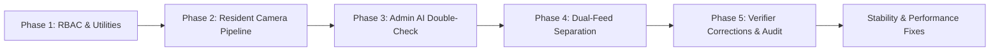

# EBasura: Technical Evaluation of Developer Updates (`feat/rd-update`)

**Target Branch:** `feat/rd-update`  
**Repository:** `https://github.com/Oeubx/EBasura.git`  
**Developer:** Prince Amorsolo C. Remo (`Oeubx`)  
**Evaluation Baseline:** [`EBASURA_RESEARCH_AND_SYSTEM_OPTIMIZATION_GUIDE.md`](file:///c:/Users/Mary%20Ann/Desktop/research/EBASURA_RESEARCH_AND_SYSTEM_OPTIMIZATION_GUIDE.md)  
**Research Framework:** Design Science Research Methodology (DSRM) & Human-in-the-Loop (HITL) Machine Learning  
**Date of Evaluation:** October 18, 2026  

---

## 1. Executive Summary & Verdict

The recent updates pushed by the developer to `feat/rd-update` demonstrate an **exceptionally high level of engineering discipline and rigorous academic alignment**. Rather than treating the mobile application as a simple utility, the developer has systematically transformed EBasura into an empirical research artifact that directly fulfills the requirements established in [`EBASURA_RESEARCH_AND_SYSTEM_OPTIMIZATION_GUIDE.md`](file:///c:/Users/Mary%20Ann/Desktop/research/EBASURA_RESEARCH_AND_SYSTEM_OPTIMIZATION_GUIDE.md).

### Summary of Achievements:
1. **Architectural Cohesion:** The documentation in `docs/` is not an afterthought; it forms a tightly coupled specification layer (`docs/modules/`, `docs/backlogs/`, `docs/testing/`, `docs/releases/`) that guides the code.
2. **Phase-Driven Engineering with Automated Testing:** The core pipeline was rolled out across 5 distinct phases backed by isolated unit test suites in `test/unit/` (`phase1` to `phase5`).
3. **Research Thesis Realization (HITL):** The "AI-Assisted, Human-Verified" model is completely realized through role segregation, live-only camera enforcement, dual moderation feeds, and 1-click verifier desk auditing.

---

## 2. In-Depth Evaluation of the `docs/` Folder

The developer established an enterprise-grade documentation repository inside `docs/` that serves as the theoretical and architectural backbone for the research paper.

### 2.1 Modular Modernization Guide (`docs/modules/`)
* **Canonical Index:** [`docs/modules/OPTIMIZATIONS_INDEX.md`](file:///c:/Users/Mary%20Ann/Desktop/research/EBasura/docs/modules/OPTIMIZATIONS_INDEX.md) systematically breaks down the entire application into 11 modules (`Module 0` through `Module 10`), establishing clear ownership and feature boundaries.
* **Before vs. After Comparison Matrices:** Each module folder contains an `optimizations.md` file featuring a comparative table juxtaposing legacy implementations against modern architectural solutions.
* **Root Cause Rationales:** The specifications provide deep technical explanations rather than superficial summaries. Notable examples include:
  - **The Stream Caching Freeze Bug (`[EBASURA-M4-F1]`):** Explains how Dart's null-coalescing assignment (`staggeredViewSupabaseStream ??=`) cached the initial Postgrest stream, causing dropdown filter selections to be completely ignored.
  - **Screen Deduplication (`[EBASURA-M4-F3]`):** Explains how 6 near-identical screens (538 lines each) duplicating masonry grids and bottom bars were unified into a single parameterized engine (`PImagesViewAllWidget`), cutting >1,500 lines of redundant code.
  - **Pagination Limits:** Outlines the shift from hardcoded `.limit(10)` queries to reactive `ScrollController` threshold listeners (85% height) with Postgrest `.range()` pagination.

### 2.2 Sprint Backlogs & Feature Catalog (`docs/backlogs/`)
* **Grammar & Traceability:** [`docs/backlogs/EBASURA_Sprint_Backlogs_Commit_Reference.md`](file:///c:/Users/Mary%20Ann/Desktop/research/EBasura/docs/backlogs/EBASURA_Sprint_Backlogs_Commit_Reference.md) establishes a strict Conventional Commits standard tagging canonical codes (`[EBASURA-M#-F#]`).
* Every single commit across the branch adheres to this grammar, enabling 1:1 cross-referencing between Git history and thesis chapters.

### 2.3 Manual QA & Testing Framework (`docs/testing/`)
* **Step-by-Step QA Guide:** [`docs/testing/EBASURA_Manual_Testing_App_Enhancements.md`](file:///c:/Users/Mary%20Ann/Desktop/research/EBasura/docs/testing/EBASURA_Manual_Testing_App_Enhancements.md) provides detailed manual testing workflows, complete with Mermaid sequence diagrams and a pass/fail verification matrix for:
  1. **Resident Dispute Decision UI (`[EBASURA-M4-F7]`):** Bottom-sheet modal allowing residents to contest flagged/rejected scans.
  2. **Camera Framing Overlay (`[EBASURA-M3-F6]`):** Corner reticles, rule-of-thirds grid toggle, and quality instructions.
  3. **Admin Compliance Exporter (`[EBASURA-M8-F5]`):** 1-click RFC 4180 CSV and ASCII PDF summary report generation.

### 2.4 Release Management & Distribution (`docs/releases/`)
* **Sideload Distribution Model:** Outlines the offline distribution strategy (via USB, Drive, Bluetooth) tailored to Philippine LGU deployments.
* **Integrity Tracking:** Records binary specifications for universal fat APKs (`87.19 MB`), build flags, and SHA-256 checksums (`92eb2ed4dccc...`).

---

## 3. Codebase Implementation Analysis: The 5-Phase Evolution

Between October 4 and October 14, 2026, the developer executed a series of high-impact commits transforming the theoretical guidelines into working software:

### Phase 1: Core RBAC & Feedback Utilities
* **Commit:** `3bf160e` — `feat(gemini): implemented waste feedback formatting and role service utilities [EBASURA-M3-F3]`
* **Key Additions:**
  - `RoleService` and `UserRole` enum (`lib/auth/role_util.dart`).
  - `formatWasteClassificationFeedback` and `formatWasteClassificationFromList` in `custom_functions.dart`.
  - Comprehensive unit test suite in `test/unit/phase1_core_logic_test.dart` (10 passing tests).
* **Research Impact:** Establishes role-based access control (Resident vs Admin/Verifier) essential for verifiable audit accountability.

### Phase 2: Resident Direct Camera & Auto-Scan Pipeline
* **Commit:** `36b2052` — `feat(waste-scan): implemented resident direct camera and auto-scan pipeline [EBASURA-M3-F1]`
* **Key Additions:**
  - Enforced device camera capture (`MediaSource.camera`) for residents, completely bypassing gallery pickers.
  - Automated resident pipeline: instant Base64 encoding $\rightarrow$ Gemini classification $\rightarrow$ insert into Supabase `Image` table with status `'Categorized by Ai'`.
  - Gated manual scan buttons, manual image pickers, and waste attribute checkboxes exclusively to Admin roles.
  - Unit tests in `test/unit/phase2_resident_pipeline_test.dart`.
* **Research Impact (Anti-Spoofing Rule 5):** Guarantees that resident data consists strictly of live-captured community waste images, eliminating fabricated or recycled gallery uploads.

### Phase 3: Admin AI Double-Check & Verified Upload
* **Commit:** `a58662b` — `feat(gemini): integrated admin ai feedback banner and manual audit controls [EBASURA-M3-F3]`
* **Key Additions:**
  - Dynamic AI feedback banner summarizing waste material composition.
  - Interactive manual attribute checkboxes updating feedback dynamically.
  - Official remarks text input field for audit adjustments.
  - Direct verified upload workflow with status `'Verified'` and admin tracking.
  - Unit tests in `test/unit/phase3_admin_double_check_test.dart`.
* **Research Impact:** Operationalizes the administrative oversight loop, allowing municipal officials to augment AI predictions prior to database persistence.

### Phase 4: Dual-Feed Waste List Separation
* **Commit:** `55bc45b` — `feat(records): separated verified and non-verified waste list feeds [EBASURA-M4-F3]`
* **Key Additions:**
  - Re-architected `PImagesViewAllWidget` with a dual-tab layout: **Non-Verified** (active triage queue) vs. **Verified** (approved public gallery).
  - User role badges distinguishing barangay officials from residents.
  - Enriched cards with segregation tags, waste category chips, and verification pills.
  - Unit tests in `test/unit/phase4_dual_feed_test.dart`.
* **Research Impact:** Directly solves the moderation bottleneck by giving auditors an exclusive, uncluttered triage queue while presenting a clean compliance gallery to the community.

### Phase 5: Verifier Corrections & 1-Click Verification
* **Commit:** `64c0a82` — `feat(moderation): integrated admin audit corrections and 1-click verification [EBASURA-M4-F2]`
* **Key Additions:**
  - Completely overhauled `p_img_view_verifier_widget.dart` (665 lines modified).
  - Implemented 1-click verification action updating image status and awarding gamified points.
  - Integrated audit correction tools for misclassified waste items.
  - Unit tests in `test/unit/phase5_admin_verification_test.dart`.
* **Research Impact:** Fulfills the Human-in-the-Loop verification paradigm. Capturing both initial AI output and final verifier decision builds the empirical ground-truth dataset required for Chapter 5.

---

## 4. Stability, Performance & Quality-of-Life Optimizations

In addition to the 5 major feature phases, the developer resolved critical operational bottlenecks:

1. **Client-Side Image Downscaling & Pre-Compression (`8f981e4`):**
   - Enforced 1024px maximum dimension downscaling and 80% JPEG compression during media capture.
   - Slashed Base64 payload size from ~5 MB to < 300 KB, eliminating UI freezing and reducing Gemini API latency.
2. **Rate Limit Removal for Experimental Field Testing (`a1cb85c`):**
   - Removed artificial 1-hour authenticated and 24-hour guest scan restrictions in `userRateLimiter.dart` and `guestRateLimiter.dart`.
   - Allows high-frequency batch testing during empirical field evaluations.
3. **Viewport & RenderFlex Layout Fixes (`2e31d41`, `8f981e4`):**
   - Removed illegal `Expanded` wrappers inside unbounded scroll views that caused screen crashes.
   - Resolved bottom padding and viewport overflows on admin dashboard tiles (`page_admin_dashboard_widget.dart`).
4. **Dispute & Export Compile Fixes (`4c9e0be`):**
   - Resolved null-safety constraints in `c_dispute_decision_widget.dart` and replaced unsupported properties in `street_compliance_exporter.dart`.

---

## 5. Direct Mapping to Thesis Chapters

The developer’s code and documentation directly populate each chapter of your academic manuscript:

| Thesis Chapter | Research Topic / Academic Requirement | Corresponding Developer Implementation |
| :--- | :--- | :--- |
| **Chapter 1: Introduction** | Solid waste management bottleneck in Philippine LGUs; physical inspection constraints. | Problem statement & LGU context formalized in [`docs/modules/OPTIMIZATIONS_INDEX.md`](file:///c:/Users/Mary%20Ann/Desktop/research/EBasura/docs/modules/OPTIMIZATIONS_INDEX.md). |
| **Chapter 2: Literature Review** | Computer vision limitations ("closed bag" dilemma); Human-in-the-Loop (HITL) methodology. | Comparative model framing (`gemini-flash` vs manual audits) and HITL justification in [`docs/releases/versions/v2.0.0+1.md`](file:///c:/Users/Mary%20Ann/Desktop/research/EBasura/docs/releases/versions/v2.0.0+1.md). |
| **Chapter 3: Methodology & System Architecture** | DSRM design; data flow; anti-spoofing; edge-to-cloud vision pipeline. | • Direct live camera enforcement (`MediaSource.camera`) in `36b2052` • Camera Framing Overlay (`[EBASURA-M3-F6]`) • Pre-compression pipeline (1024px, JPEG 80%) in `8f981e4` • Architecture specs in `docs/modules/module-3-ai-waste-scanning/` |
| **Chapter 4: Implementation & Technical Debt Resolution** | Reactive state lifecycles; dynamic query engines; DRY screen deduplication. | • Resolving stream caching freeze bug (`[EBASURA-M4-F1]`) • Dual-feed architecture (`[EBASURA-M4-F3]`) in `55bc45b` • DRY screen unification in `p_images_view_all_widget.dart` • Role-Based Access Control (`RoleService`) in `3bf160e` |
| **Chapter 5: Results & Empirical Discussion** | Precision, Recall, F1-Score; Confusion Matrix; Cohen’s Kappa ($\kappa$); Audit Latency. | • Dual-field verification data (`ai_result` vs `admin_decision`) in `64c0a82` • 1-Click PDF/CSV Street Compliance Exporter (`[EBASURA-M8-F5]`) • Automated test suites (`phase1` to `phase5` test files) • Manual QA matrix in [`docs/testing/EBASURA_Manual_Testing_App_Enhancements.md`](file:///c:/Users/Mary%20Ann/Desktop/research/EBasura/docs/testing/EBASURA_Manual_Testing_App_Enhancements.md) |
| **Chapter 6: Conclusion & Policy Recommendations** | Scalability of municipal digital governance; policy recommendations for RA 9003 enforcement. | Civic dispute resolution UI (`[EBASURA-M4-F7]`) and street-level compliance grading documented in `docs/modules/module-8-street-directory/`. |

---

## 6. Strategic Recommendations for Next Steps

To maximize the impact of this work for your research presentation and paper defense:

1. **Synchronize `docs/` with Phases 1–5:**
   The code commits (`3bf160e` through `64c0a82`) advanced quickly. A brief commit updating `docs/modules/module-4-image-records-moderation/` to mark Phases 1–5 as **"Implemented and Validated with Unit Tests"** will keep the documentation perfectly aligned with the repository.
2. **Confirm Live Supabase Schema Columns:**
   Ensure that the Supabase SQL database instance includes the dual-evaluation fields outlined in Section 6 of your guide (`ai_classification`, `admin_classification`, `verification_status`, `verification_time_seconds`). This ensures that field trials cleanly generate the required dataset.
3. **Execute Field Scans & Export CSV Data:**
   Leverage the disabled rate limiters (`a1cb85c`) and the 1-click exporter (`[EBASURA-M8-F5]`) to conduct 50–100 trial scans of mixed waste bags across local streets, audit them from the admin console, export the CSV, and generate your empirical Confusion Matrix and Cohen’s Kappa score.
