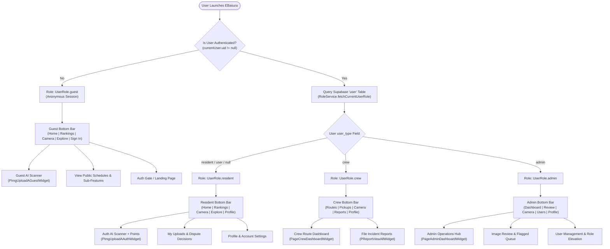

# Role-Based Access Control (RBAC) & Navigation Directory

## 1. Overview & Architecture

EBasura enforces a client-side and backend-verified **Role-Based Access Control (RBAC)** architecture designed to balance open public accessibility for waste awareness with strict data isolation and elevated administrative governance.

The platform distinguishes four distinct operational tiers:
1. **Guest (`UserRole.guest`)**: Unauthenticated visitors or first-time community users exploring recycling guides, checking collection schedules, and testing AI waste classification without an account.
2. **Resident (`UserRole.resident`)**: Verified community members with confirmed email credentials participating in daily waste classification, earning gamification points, unlocking badges, filing waste disputes, and tracking personal scan histories.
3. **Collection Crew (`UserRole.crew`)**: Municipal or barangay waste collection personnel operating specialized route tracking, live street collection checklists, shift status management, and route-level incident reporting.
4. **Administrator (`UserRole.admin`)**: Barangay officials and system administrators managing platform moderation, reviewing flagged uploads, adjusting user roles, updating street collection schedules, and authoring achievement badges.



---

## 2. Master Access Control Matrix

The following matrix cross-references application features with permitted user tiers:

| Functional Area | Route / Primary Component | Guest (`guest`) | Resident (`resident`) | Crew (`crew`) | Admin (`admin`) |
| :--- | :--- | :---: | :---: | :---: | :---: |
| **Auth Gateway & Registration** | `LandingPageWidget` (`/landingPage`) | Full Access | Auto-redirect | Auto-redirect | Auto-redirect |
| **Guest AI Waste Scanner** | `PImgUploadAGuestWidget` (`/pImgUploadAGuest`) | Full Access | Optional | Optional | Optional |
| **Authenticated AI Scanner** | `PImgUploadAAuthWidget` (`/pImgUploadAAuth`) | Gated (Prompt Sign In) | Full Access (Awards Points) | Full Access | Full Access |
| **Gamification Points & Streaks** | `lib/custom_code/actions/` | Read-only | Earn & Level-up | View | Manage/Audit |
| **Personal Uploads Archive** | `PImagesViewAllUserWidget` (`/pImagesViewAllUser`) | Gated | Full Access | Full Access | Full Access |
| **Community Leaderboard** | `PageLeaderboardWidget` (`/pageLeaderboard`) | Read-only Feed | Ranked Participant | Participant | Moderator View |
| **Waste Incident Reporting** | `PReportViewAllWidget` / `CReportCreationWidget` | Gated | Read completed audits | Submit Reports | Submit & Resolve |
| **Public Schedules & Streets** | `PDatesViewAllWidget`, `PStreetViewOneWidget` | Read-only | Read & Filter | Assigned Routes | Full CRUD |
| **Sub-Features Directory** | `PageViewSubFeaturesWidget` (`/pageViewSubFeatures`) | Read-only | Full Access | Full Access | Full Access |
| **Profile & Settings** | `PageProfileWidget` (`/pageProfile`) | Gated (Sign In CTA) | Full Access | Full Access | Full Access |
| **Crew Dispatch Dashboard** | `PageCrewDashboardWidget` (`/pageCrewDashboard`) | Blocked | Blocked | Full Access | Viewable |
| **Admin Operations Dashboard** | `PageAdminDashboardWidget` (`/pageAdminDashboard`) | Blocked | Blocked | Blocked | Full Access |
| **User Role & Points Management** | `PageUserManagementWidget` (`/pageUserManagement`) | Blocked | Blocked | Blocked | Full Access |
| **Image Moderation & Verifier** | `PImagesViewAllWidget`, `PImgViewVerifierWidget` | Blocked | Blocked | Blocked | Full Access |
| **Flagged Images & AI Quarantine** | `PageFilteredImagesWidget` (`/pageFilteredImages`) | Blocked | Blocked | Blocked | Full Access |
| **Schedule & Street Authoring** | `lib/admin/dates/`, `lib/admin/street/` | Blocked | Blocked | Blocked | Full CRUD |
| **Badge Creation & Revocation** | `PBadgeViewAllWidget`, `lib/admin/badges/` | Blocked | Blocked | Blocked | Full CRUD |

---

## 3. Dynamic Navigation Engine (`CBottomBarWidget`)

Navigation adaptation is orchestrated centrally through `lib/components/c_bottom_bar/c_bottom_bar_widget.dart`. On initialization, the widget inspects the current authentication state and evaluates `RoleService.fetchCurrentUserRole()`:

```dart
// Role-based Bottom Bar Layout Selector
if (_currentRole == UserRole.crew) {
  // Routes | Pickups | [Camera FAB] | Reports | Profile
} else if (_currentRole == UserRole.admin) {
  // Dashboard | Review | [Camera FAB] | Users | Profile
} else {
  // Home | Rankings | [Camera FAB] | Explore | Profile (or Sign In if Guest)
}
```

The center Floating Action Button (FAB) dynamically redirects based on role:
- **Guests (`currentUserUid.isEmpty`)**: Redirects to `PImgUploadAGuestWidget` with `autoTriggerCamera: true`.
- **Residents (`_currentRole == UserRole.resident`)**: Redirects to `PImgUploadAAuthWidget` with `autoTriggerCamera: true`.
- **Crew / Admins**: Redirects to `PImgUploadAAuthWidget` in manual review/inspection mode.

---

## 4. Role Documentation & Testing Directory

For complete lists of accessible features, route identifiers, screen inventories, interactive controls, and step-by-step navigation instructions for each role, consult the dedicated guides below:

1. 📊 **[`crud_matrix.md`](crud_matrix.md)** — Master CRUD & USE Action Matrix across all 8 platform modules with operation-level checkmarks and Supabase table mappings.
2. 📖 **[`guest_access.md`](guest_access.md)** — Comprehensive guide for Guest users: unauthenticated exploration, guest scanning, and auth conversion gates.
3. 📖 **[`resident_access.md`](resident_access.md)** — Comprehensive guide for Community Residents: camera flows, points & badges, uploads archive, dispute appeals, and account management.
4. 📖 **[`crew_access.md`](crew_access.md)** — Comprehensive guide for Collection Crew: shift status management, live street collection checklists, field camera scanning, and incident reporting.
5. 📖 **[`admin_access.md`](admin_access.md)** — Comprehensive guide for Barangay Administrators: KPI dashboards, moderation galleries, verifier overrides, user role editing, schedule authoring, and security audits.
6. ✅ **[`qa_verification_checklist.md`](qa_verification_checklist.md)** — Master hands-on QA testing runbook containing 45 self-verification test cases across all 4 roles, including a database role-switching guide.
