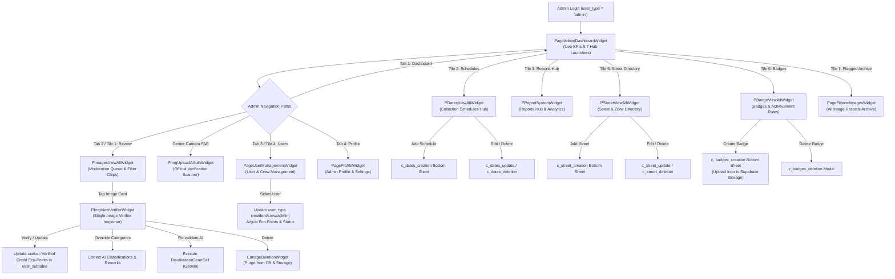

# Administrator Access & Navigation Guide

## 1. User Persona & Scope

The **Administrator** tier (`UserRole.admin`) is granted to Barangay Officials, municipal waste management supervisors, and platform administrators whose accounts possess the elevated role `user_type = 'admin'` in the Supabase `user` table.

Administrators maintain complete operational governance over the entire EBasura ecosystem:
- **Platform Analytics**: Monitoring live community scan metrics, verified recyclables, pending queues, and monitored streets.
- **Waste Verification & Scoring**: Reviewing Gemini AI classifications, approving or overriding categories, scoring community eco-points, and resolving disputed resident scans.
- **AI Anomaly & Prompt Injection Quarantine**: Moderating suspicious or malicious uploads in the flagged queue.
- **User & Crew Administration**: Elevating resident accounts to Collection Crew or Administrator roles, adjusting points, and inspecting user activity.
- **Logistics Administration**: Authoring, updating, and retiring scheduled waste collection pickups and assigning crews.
- **Barangay Geography**: Defining street directories, collection zones, and communal storage points.
- **Gamification Authoring**: Creating custom eco-badges, uploading icons to Supabase Storage, and defining point unlock criteria.
- **Incident Resolution**: Overseeing community waste dumping reports, dispatching crew cleanups, and updating resolution states.

---

## 2. Complete List of Accessible Features

| Feature ID | Screen / Component Name | Route Path | Primary Purpose |
| :--- | :--- | :--- | :--- |
| **ADM-01** | `PageAdminDashboardWidget` | `/pageAdminDashboard` | Central administrative command center featuring live KPI counters and 7 core module launchers. |
| **ADM-02** | `PImagesViewAllWidget` | `/pImagesViewAll` | Master image moderation gallery with tabbed classification filters (All, AI, Segregated, Flagged, Verified). |
| **ADM-03** | `PImgViewVerifierWidget` | `/pImgViewVerifier` | Deep audit inspector: verify AI predictions, override categories, adjust remarks, trigger AI revalidation, or delete scans. |
| **ADM-04** | `PageFilteredImagesWidget` | `/pageFilteredImages` | Dedicated historical quarantine and anomaly review queue for non-waste content and prompt injections. |
| **ADM-05** | `PImagesViewAllFlaggedWidget` | `/pImagesViewAllFlagged` | Filtered gallery isolating community-flagged and disputed waste submissions. |
| **ADM-06** | `PImagesViewAllVerifiedWidget` | `/pImagesViewAllVerified` | Filtered gallery of officially verified and point-credited waste submissions. |
| **ADM-07** | `PImagesViewAllSegregatedWidget` | `/pImagesViewAllSegregated` | Filtered gallery of confirmed clean segregated recyclables and biodegradables. |
| **ADM-08** | `PImagesViewAllUnsegregatedWidget` | `/pImagesViewAllUnsegregated` | Filtered gallery of mixed, unsegregated, or contaminated waste submissions. |
| **ADM-09** | `PImagesViewAllAiWidget` | `/pImagesViewAllAi` | Filtered gallery of raw Gemini AI classifications awaiting official human audit. |
| **ADM-10** | `PageUserManagementWidget` | `/pageUserManagement` | User management console: search users, elevate roles (Resident -> Crew -> Admin), credit points, or view status. |
| **ADM-11** | `PDatesViewAllWidget` | `/pDatesViewAll` | Collection schedules administration hub with Add/Edit/Delete action triggers. |
| **ADM-12** | `c_dates_creation` | Bottom Sheet / Modal | Form modal to schedule new garbage collection dates, time ranges, and assigned zones. |
| **ADM-13** | `c_dates_update` | Bottom Sheet / Modal | Form modal to modify existing pickup times, assigned drivers, or notes. |
| **ADM-14** | `c_dates_deletion` | Confirmation Dialog | Secure deletion dialog to cancel and purge obsolete collection schedules. |
| **ADM-15** | `PStreetViewAllWidget` | `/pStreetViewAll` | Barangay street and zone directory hub with Add/Edit/Delete action triggers. |
| **ADM-16** | `c_street_creation` | Bottom Sheet / Modal | Form modal to register new streets, subdivisions, or collection zones into the directory. |
| **ADM-17** | `c_street_update` | Bottom Sheet / Modal | Form modal to edit street names, zone assignments, and storage bin indicators. |
| **ADM-18** | `c_street_deletion` | Confirmation Dialog | Secure deletion dialog to retire streets from the directory. |
| **ADM-19** | `PBadgeViewAllWidget` | `/pBadgeViewAll` | Gamification badge authoring console: create custom badges, upload icon assets, and set unlock thresholds. |
| **ADM-20** | `c_badges_creation` | Bottom Sheet / Modal | Form modal to author new achievement badges with icon upload to Supabase Storage. |
| **ADM-21** | `c_badges_deletion` | Confirmation Dialog | Secure deletion dialog to retire or revoke deprecated badges. |
| **ADM-22** | `PReportViewAllWidget` | `/pReportViewAll` | Master incident report management queue to oversee and resolve resident dumping complaints. |
| **ADM-23** | `PReportViewOneWidget` | `/pReportViewOne` | Detailed incident inspector to update report resolution status (`Pending`, `In Progress`, `Resolved`). |
| **ADM-24** | `PReportSystemWidget` | `/pReportSystem` | Administrative waste audit filing tool and street waste health analytics hub. |
| **ADM-25** | `PImgUploadAAuthWidget` | `/pImgUploadAAuth` | Authenticated camera scanner for on-site administrative waste verification. |
| **ADM-26** | `PageProfileWidget` | `/pageProfile` | Admin profile card displaying official name, email, role badge (`Admin`), and credentials. |
| **ADM-27** | `PageProfileSettingsWidget` | `/pageProfileSettings` | Administrative account settings hub for password updates and session logout. |

---

## 3. Visual Screen Inventory (What You See)

### 3.1 Admin Command Center Dashboard (`PageAdminDashboardWidget`)
- **Header (`CPageHeaderWidget`)**:
  - Shield with Admin settings icon (`Icons.admin_panel_settings_rounded`).
  - Title: *"Admin Command Center"*.
  - Subtitle: *"Barangay waste management, moderation queue & field operations"*.
- **2x2 Live KPI Grid (`_buildKpiGrid`)**:
  - **Total Scans Card**: Citizen submissions count (`Icons.photo_library_rounded`, Ocean Blue `#2E78A6` icon, Sky Blue `#A3C9D9` container).
  - **Verified Recyclables Card**: Confirmed classifications count (`Icons.check_circle_rounded`, Eco Green `#31A11F` icon, Mint Tint `#D5F2E2` container).
  - **Pending Moderation Card**: Queue count awaiting review (`Icons.pending_actions_rounded`, Orange `#E65100` icon when > 0 with badge *"X Pending"*, or Green *"Queue clear"*).
  - **Monitored Streets Card**: Active waste zones count (`Icons.signpost_rounded`, Leaf Green `#70BF5A` icon, Mint Tint container).
- **Operations Hub Launchpad (`_buildOperationsHub`)**:
  - Section Heading: *"Management & Operations"*.
  - **Tile 1: Waste Verification Queue**: Subtitle *"Review & verify community waste scan submissions"*, Ocean Blue icon, dynamic badge showing pending count.
  - **Tile 2: Collection Schedules**: Subtitle *"Manage pickup timing, routes, and assigned collectors"*, Eco Green icon.
  - **Tile 3: Reports Hub & Analytics**: Subtitle *"Street waste health, verification tallies & collection reports"*, Ocean Blue icon.
  - **Tile 4: User & Crew Management**: Subtitle *"Assign roles, inspect resident profiles & crew accounts"*, Ocean Blue icon.
  - **Tile 5: Street & Zone Directory**: Subtitle *"Configure barangay street boundaries & storage bins"*, Leaf Green icon.
  - **Tile 6: Badges & Achievement Rules**: Subtitle *"Configure eco milestones, point rules & badge rewards"*, Amber `#D97706` icon.
  - **Tile 7: All Image Records Archive**: Subtitle *"Filter historical waste submissions by category & AI flag"*, Sky Blue icon.
- **Admin Bottom Navigation Bar (`CBottomBarWidget`)**:
  - Tab 1: **Dashboard** (`Icons.admin_panel_settings_rounded`)
  - Tab 2: **Review** (`Icons.verified_user_rounded`)
  - Center: **Elevated Camera FAB** (Ocean Blue circle with Eco Green border)
  - Tab 3: **Users** (`Icons.group_rounded`)
  - Tab 4: **Profile** (`Icons.person_rounded`)

### 3.2 Master Image Review & Moderation Hub (`PImagesViewAllWidget`)
- **Header Bar**: Title *"Waste Verification Queue"* with back button and active tab counters.
- **Horizontal Filter Chips Bar**:
  - `All`: Complete archive of community waste scans.
  - `AI Classified`: Scans evaluated by Gemini AI awaiting official review (`PImagesViewAllAiWidget`).
  - `Segregated`: Confirmed clean recyclable and compostable waste (`PImagesViewAllSegregatedWidget`).
  - `Unsegregated`: Mixed or contaminated waste items (`PImagesViewAllUnsegregatedWidget`).
  - `Flagged`: Suspicious, non-waste, or resident-disputed uploads (`PImagesViewAllFlaggedWidget`).
  - `Verified`: Formally approved scans with points awarded (`PImagesViewAllVerifiedWidget`).
- **Scan Grid / List**:
  - Thumbnail preview of uploaded waste photo.
  - AI classification prediction tags (e.g., `Recyclable`, `Plastic Bottle`, `Confidence: 94%`).
  - Uploader name, timestamp, and current status pill (`Pending`, `Verified`, `Flagged`).

### 3.3 Deep Single-Image Verifier & Audit Inspector (`PImgViewVerifierWidget`)
- **Top Brand Bar**: Back button, centered horizontal EBasura logo.
- **High-Resolution Waste Photo**: Full-screen inspectable image with zoom/pinch capability.
- **AI Classification Breakdown**:
  - Gemini model prediction, detected objects, confidence score, and segregation analysis.
- **Interactive Verification & Override Controls**:
  - **Segregated Toggle**: `Switch` to confirm or override whether waste is properly segregated.
  - **Category Checkboxes**: Multi-select options for `Recyclable`, `Biodegradable`, and `Non-Biodegradable`.
  - **Official Remarks Field**: Text field to enter audit justification notes (default: *"Verified by official"*).
- **Audit Action Bar**:
  - **"Verify" / "Update" Button**: Forest Green (`#2E7D32`) pill with `Icons.verified_rounded`. Formally certifies scan, computes latency, and credits eco-points.
  - **"Re-validate with AI" Button**: Triggers real-time base64 Gemini AI re-analysis (`RevalidationScanCall`).
  - **"Disable Flag" Button**: Visible if status is `Flagged`. Allows clearing the flag and restoring user standing.
  - **"Delete" Button**: Crimson Red (`#C44545`) pill with `Icons.edit_note`. Triggers `CImageDeletionWidget` deletion confirmation.

### 3.4 User & Crew Management Console (`PageUserManagementWidget`)
- **Header Bar**: Title *"User Management"*, subtitle *"Community roles & permissions"*.
- **Live Search & Role Filter**: Text field to search by name/email, with filter pills for `All`, `Residents`, `Crew`, `Admins`.
- **User Cards List**:
  - User avatar, full name, email address, role badge (`Resident`, `Crew`, `Admin`), and current eco-points tally.
- **User Action Bottom Sheet**:
  - Role dropdown selector (`resident`, `crew`, `admin`).
  - Eco-points manual credit/debit input field.
  - Account status toggle.

### 3.5 Collection Schedules Administration Hub (`PDatesViewAllWidget`)
- **Header**: Title *"Collection Schedules"* with calendar icon and `+ Add Schedule` action button.
- **Schedule Card Deck**:
  - Assigned collection date, route time window (e.g., `08:00 AM - 11:30 AM`).
  - Assigned street/zone name and truck crew tag.
  - Edit (pencil) and Delete (trash) quick-action icon buttons.
- **Authoring Modals**:
  - `c_dates_creation`: Modal bottom sheet with date picker, time spinners, zone picker, and crew assignment.
  - `c_dates_update`: Pre-populated edit modal to update route times or driver notes.
  - `c_dates_deletion`: Deletion modal with warning that residents in the zone will no longer see the pickup.

### 3.6 Street & Zone Directory Hub (`PStreetViewAllWidget`)
- **Header**: Title *"Street & Zone Directory"* with `+ Add Street` button.
- **Street Card Directory**:
  - Street name, barangay zone, and storage bin indicators (`has_storage: true/false`).
  - Edit and Delete icon buttons.
- **Authoring Modals**:
  - `c_street_creation`: Modal form to register new streets into the directory.
  - `c_street_update`: Edit street boundaries and storage facilities.
  - `c_street_deletion`: Deletion modal to retire streets from collection coverage.

### 3.7 Achievement Badges Hub (`PBadgeViewAllWidget`)
- **Header**: Title *"Badges & Achievement Rules"* with `+ Create Badge` action button.
- **Badge Catalog Deck**:
  - Badge icon image, title, description, points threshold, and required scan milestone count.
- **Authoring Modals**:
  - `c_badges_creation`: Bottom sheet modal with title, description, unlock thresholds, and file picker to upload badge icon PNG directly to Supabase `badges` storage bucket.
  - `c_badges_deletion`: Dialog to retire deprecated gamification badges.

---

## 4. Interactive Controls Inventory (What You Use)

| Control Name | UI Component / Style | Color & Geometry | Trigger Action / Effect |
| :--- | :--- | :--- | :--- |
| **Verify / Update Button** | `FFButtonWidget` in `PImgViewVerifierWidget` | Forest Green (`#2E7D32`), 8.0px radius, elevated | Updates `Image` row to `status = 'Verified'`, calculates agreement (`verified` vs `corrected`), awards eco-points, records verification latency. |
| **Revalidate AI Button** | `FFButtonWidget` in `PImgViewVerifierWidget` | Sky Blue (`#A3C9D9`), 8.0px radius | Converts image to base64, invokes `RevalidationScanCall`, and refreshes AI predicted waste categories. |
| **Disable Flag Button** | `FFButtonWidget` in `PImgViewVerifierWidget` | Neutral White / Ocean Blue border | Clears the image flag (`allowFlagging: false`) and dismisses quarantine. |
| **Delete Image Button** | `FFButtonWidget` in `PImgViewVerifierWidget` | Crimson Red (`#C44545`), 8.0px radius | Opens `CImageDeletionWidget` bottom sheet to permanently purge image from database and storage. |
| **Segregated Toggle** | `Switch` in `PImgViewVerifierWidget` | Eco Green `#31A11F` active track | Toggles whether scan is certified as properly segregated (`isSegregated = true/false`). |
| **Waste Category Checkboxes** | `Checkbox` in `PImgViewVerifierWidget` | Eco Green `#31A11F` check | Overrides individual categories: `category_recycling`, `category_biode`, `category_nonbiode`. |
| **Official Remarks Input** | `TextFormField` in `PImgViewVerifierWidget` | Neutral Canvas `#F2F2F2` fill, 8.0px radius | Enters human auditor explanation saved to `Image.remark`. |
| **Add Schedule FAB / Button** | `FFButtonWidget` in `PDatesViewAllWidget` | Ocean Blue `#2E78A6`, pill geometry | Opens `c_dates_creation` bottom sheet to register a new collection date. |
| **Add Street Button** | `FFButtonWidget` in `PStreetViewAllWidget` | Leaf Green `#70BF5A`, pill geometry | Opens `c_street_creation` bottom sheet to add a street to the directory. |
| **Create Badge Button** | `FFButtonWidget` in `PBadgeViewAllWidget` | Amber `#D97706`, pill geometry | Opens `c_badges_creation` bottom sheet with icon asset uploader. |
| **User Role Dropdown** | `Dropdown` in `PageUserManagementWidget` | White card, rounded border | Changes selected user's role attribute (`resident`, `crew`, `admin`) in `user` table. |
| **Points Adjustment Input** | `TextFormField` in `PageUserManagementWidget` | White card, rounded border | Manually credits or debits points in `user_subtable` with an audit reason. |
| **Center Camera FAB** | Elevated circular button in `CBottomBarWidget` | Ocean Blue circle, Eco Green 2.5px border | Opens authenticated camera scanner (`PImgUploadAAuthWidget`) for field verification. |

---

## 5. End-to-End User Flow & Navigation Journey

### 5.1 Verification & Scoring Flow
1. Authenticate with Administrator credentials (`user_type = 'admin'`).
2. Landing on `PageAdminDashboardWidget`, observe the **Pending Moderation** KPI tile.
3. Tap **"Waste Verification Queue"** (or Tab 2 **Review** on the bottom bar).
4. `PImagesViewAllWidget` opens displaying pending submissions.
5. Tap an unverified image card to open `PImgViewVerifierWidget`.
6. Inspect the high-resolution photo and Gemini AI classification breakdown.
7. Confirm or adjust the **Segregated Switch** and **Category Checkboxes** (Recyclable, Biodegradable, Non-Biodegradable).
8. Optionally enter remarks in the text box.
9. Tap the Forest Green **"Verify"** button:
   - Supabase `Image` table updates with `status = 'Verified'`, `verification_status`, and `admin_id`.
   - Supabase `user_subtable` updates with awarded eco-points (25, 50, or 100 points depending on category count).
   - Modal closes with a success snackbar, returning to the moderation queue.

### 5.2 Collection Schedule Authoring Flow
1. From `PageAdminDashboardWidget`, tap the **"Collection Schedules"** launcher tile.
2. `PDatesViewAllWidget` opens displaying the active schedule list.
3. Tap the **"+ Add Schedule"** button.
4. `c_dates_creation` modal opens:
   - Select collection calendar date.
   - Enter start and end pickup times.
   - Select assigned barangay street/zone from dropdown.
   - Select assigned truck crew.
5. Tap **"Save Schedule"**:
   - New row inserted into Supabase `collection` table.
   - Modal dismisses and schedule immediately appears on resident and crew calendars.

### 5.3 User Role Elevation Flow
1. From `PageAdminDashboardWidget`, tap **"User & Crew Management"** (or Tab 3 **Users** on bottom bar).
2. `PageUserManagementWidget` opens with all registered users.
3. Search for the target resident by name or email.
4. Tap the user's card to open their management sheet.
5. Change the role dropdown from `resident` to `crew` or `admin`.
6. Confirm the prompt:
   - Supabase `user` table is updated with the new `user_type`.
   - On the user's next app launch or state refresh, their UI dynamically shifts to the new role navigation bar and permissions.

### 5.4 End-to-End Navigation Architecture Flowchart

---

## 6. Access Boundaries & Operational Responsibilities

Administrators possess full operational privileges, accompanied by the following governance protocols:
1. **Audit Accountability**:
   - Every verification, correction, or score adjustment records the administrator's `currentUserUid` in `Image.admin_id`, `updated_by`, and audit timestamp columns.
2. **Fair Scoring Protocol**:
   - Overriding Gemini AI classifications must adhere to standard barangay segregation guidelines (e.g., rinsed plastics = recyclable; mixed unsegregated waste = 0 points).
3. **Data Protection**:
   - Access to citizen names, emails, and photo locations must be handled strictly for official barangay municipal sanitation purposes.

---

## 7. Security Enforcement & Admin Route Guards

Administrative privileges are enforced at two levels:

1. **Client-Side RBAC Guard (`lib/auth/role_util.dart`)**:
   - Evaluated via `RoleService.isAdmin(user.userType)`.
   - If an unauthenticated user or non-admin resident attempts to navigate directly to `/pageAdminDashboard`, `/pageUserManagement`, or administrative routes, GoRouter intercepts the route and redirects to `/pageHomepage` or `/landingPage`.
2. **Backend Row-Level Security (RLS) in Supabase**:
   - Database mutation policies for tables (`collection`, `street`, `badge_record`, `user`) require `auth.jwt() ->> 'role' = 'admin'` or verified administrative claims, preventing unauthorized direct REST API manipulation.
