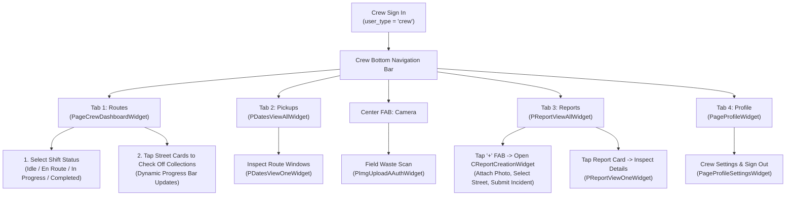

# Collection Crew Access & Navigation Guide

## 1. User Persona & Scope

The **Collection Crew** tier (`UserRole.crew`) is assigned to barangay and municipal waste collectors, truck drivers, and sanitation field workers whose accounts have `user_type = 'crew'` in the Supabase `user` table.

Collection Crew members operate the mobile application in the field to manage daily garbage truck shifts, mark streets as collected on live route checklists, inspect collection timetables, file on-route incident reports (such as overflowing bins, illegal roadside dumping, or blocked streets), and perform field verification scans.

---

## 2. Complete List of Accessible Features

| Feature ID | Screen / Component Name | Route Path | Primary Purpose |
| :--- | :--- | :--- | :--- |
| **CRW-01** | `PageCrewDashboardWidget` | `/pageCrewDashboard` | Operational hub: shift status selector, route progress bar, and street collection checklist. |
| **CRW-02** | `PDatesViewAllWidget` | `/pDatesViewAll` | Master list of barangay garbage pickup schedules, time windows, and assigned streets. |
| **CRW-03** | `PDatesViewOneWidget` | `/pDatesViewOne` | Detailed collection schedule card with pickup hours and assigned crew notes. |
| **CRW-04** | `PImgUploadAAuthWidget` | `/pImgUploadAAuth` | Authenticated camera scanner for on-field waste verification. |
| **CRW-05** | `PReportViewAllWidget` | `/pReportViewAll` | Feed of all community waste incident reports with filter chips (*All*, *Pending*, *In Progress*, *Resolved*). |
| **CRW-06** | `CReportCreationWidget` | Modal Bottom Sheet | Incident creation form to file field reports (missed collection, roadside dump) with photo capture. |
| **CRW-07** | `PReportViewOneWidget` | `/pReportViewOne` | Detailed incident inspector displaying attached photos, street location, and inspection notes. |
| **CRW-08** | `PageLeaderboardWidget` | `/pageLeaderboard` | Community recycling leaderboard view. |
| **CRW-09** | `PageProfileWidget` | `/pageProfile` | Crew profile card, credentials, and settings access. |
| **CRW-10** | `PageProfileSettingsWidget` | `/pageProfileSettings` | Account credentials, password change, and sign-out controls. |

---

## 3. Visual Screen Inventory ("What You See")

### 3.1 Crew Bottom Navigation Bar
When authenticated with `user_type = 'crew'`, `CBottomBarWidget` automatically renders the specialized 5-item crew navigation bar:

```
[ 🚛 Routes ]   [ 📋 Pickups ]   [ 📷 Camera ]   [ ⚠️ Reports ]   [ 👤 Profile ]
```

### 3.2 Routes Dashboard (`PageCrewDashboardWidget`)
Upon tapping Tab 1 (**Routes**), the screen displays:
1. **Truck Unit Status Card**:
   - Circular mint icon with truck symbol (`Icons.local_shipping_rounded`).
   - Title: *"Truck #04 • Field Crew Unit"*.
   - Subtitle: *"Barangay Central Collection Route"*.
   - Live Status Badge pill in upper right (e.g., *"In Progress"*).
2. **Shift Status Selector**:
   - 4 selectable pills: **Idle**, **En Route**, **In Progress**, **Completed**.
   - Active status is highlighted with Ocean Blue (`#2E78A6`) fill and bold white text.
3. **Street Collection Checklist Section**:
   - Header: *"Street Collection Checklist"*.
   - Dynamic counter: e.g., *"3 of 8 Done"*.
   - Animated linear progress bar filling from left to right in Eco Green (`#31A11F`).
   - Interactive street cards displaying street name, pickup window, and collection status badge.

### 3.3 Pickups Timetable (`PDatesViewAllWidget`)
Upon tapping Tab 2 (**Pickups**), the screen displays:
- Chronological list of scheduled barangay collection dates.
- Assigned truck notes and designated waste types (*Biodegradable, Recyclable, Residual*).

### 3.4 Reports Queue (`PReportViewAllWidget`)
Upon tapping Tab 4 (**Reports**), the screen displays:
- Filter chips: `All`, `Pending`, `In Progress`, `Resolved`.
- Incident report cards showing photo preview, street location, and timestamp.
- **Elevated "+" Floating Action Button (FAB)** in the bottom corner to file new field reports.

---

## 4. Interactive Controls Inventory ("What You Use")

| Component / Button | Location | Action Triggered |
| :--- | :--- | :--- |
| **Shift Status Pills** | `PageCrewDashboardWidget` | Tapping changes shift state (*Idle* $\to$ *En Route* $\to$ *In Progress* $\to$ *Completed*). |
| **Street Checklist Cards** | `PageCrewDashboardWidget` | Tapping marks street as collected; updates progress bar and counter. |
| **Center Camera FAB** | Bottom Bar | Opens `PImgUploadAAuthWidget` for on-field waste scanning. |
| **"+" Floating Action Button** | `PReportViewAllWidget` | Opens `CReportCreationWidget` modal to file a new waste incident report. |
| **Report Card Tap** | `PReportViewAllWidget` | Opens `PReportViewOneWidget` to inspect report photos and details. |
| **Date Card Tap** | `PDatesViewAllWidget` | Opens `PDatesViewOneWidget` to inspect route timing and notes. |
| **Sign Out Tile** | `PageProfileSettingsWidget` | Clears crew session tokens and returns to `LandingPageWidget`. |

---

## 5. End-to-End User Flow & Navigation Journey



---

## 6. Crew Boundaries & Security Gates

| Action Attempted | Crew Capability | Security / System Enforcement |
| :--- | :---: | :--- |
| **Mark Street Collected** | Allowed | Updates active route progress in `PageCrewDashboardWidget`. |
| **File Field Incident Report** | Allowed | Inserts new incident into Supabase `report` table via `CReportCreationWidget`. |
| **Field Waste Scan** | Allowed | Authenticated camera scan via `PImgUploadAAuthWidget`. |
| **Admin Operations Dashboard** | **Blocked** | Gated by `RoleService.isAdmin()`. Navigation intercepted. |
| **User Role Management** | **Blocked** | Gated. Cannot promote, demote, or suspend users. |
| **Author / Delete Collection Dates** | **Blocked** | Read-only. Schedule creation/deletion reserved for Admins. |
| **Author / Delete Streets** | **Blocked** | Read-only. Street directory mutations reserved for Admins. |
| **Badge Creation & Revocation** | **Blocked** | Gated. Badge authoring reserved for Admins. |
