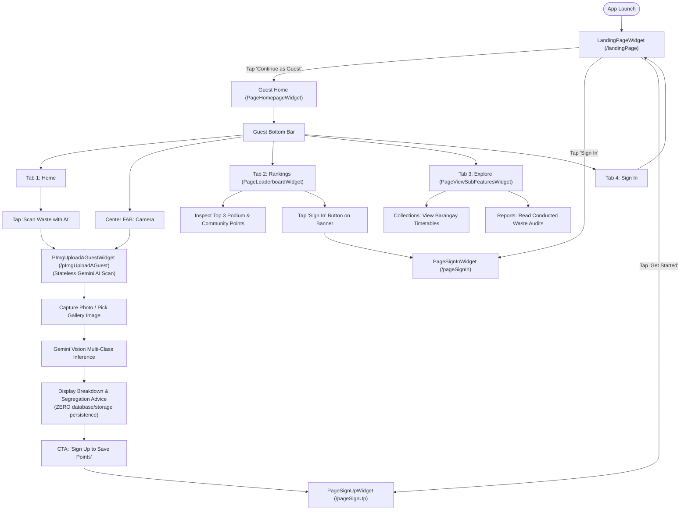

# Guest Access & Navigation Guide

## 1. User Persona & Scope

The **Guest** tier (`UserRole.guest`) is designed for community residents, visitors, and first-time users who have not yet registered or authenticated their accounts. EBasura adopts an "Open Door" sustainability philosophy: essential educational and utility features—such as checking when the garbage truck arrives, viewing public waste audit summaries, and testing the AI waste scanner—are accessible without requiring account creation.

---

## 2. Complete List of Accessible Features

| Feature ID | Screen / Component Name | Route Path | Primary Purpose |
| :--- | :--- | :--- | :--- |
| **GST-01** | `LandingPageWidget` | `/landingPage` | Welcome splash, gateway to registration, login, or guest continuation. |
| **GST-02** | `PageSignUpWidget` | `/pageSignUp` | Account registration form with name, email, street, and password. |
| **GST-03** | `PageSignInWidget` | `/pageSignIn` | Existing account authentication with email and password. |
| **GST-04** | `PageForgotPasswordWidget` | `/pageForgotPassword` | Password recovery via automated reset email. |
| **GST-05** | `TermsAndConditionsWidget` | `/termsAndConditions` | Public terms of service and data privacy notices. |
| **GST-06** | `PageVerifyEmailWidget` | `/pageVerifyEmail` | OTP verification screen to activate newly created accounts. |
| **GST-07** | `PageHomepageWidget` | `/` or `/pageHomepage` | Guest dashboard with "Eco Explorer" identity, schedule alerts, and quick actions. |
| **GST-08** | `PImgUploadAGuestWidget` | `/pImgUploadAGuest` | Guest AI Waste Scanner (Gemini vision classification with zero data persistence). |
| **GST-09** | `PDatesViewAllWidget` | `/pDatesViewAll` | Public calendar of municipal and barangay garbage collection schedules. |
| **GST-10** | `PDatesViewOneWidget` | `/pDatesViewOne` | Detailed schedule view including pickup hours and assigned waste types. |
| **GST-11** | `PStreetViewOneWidget` | `/pStreetViewOne` | Street directory entry detailing route coverage and schedules. |
| **GST-12** | `PageViewSubFeaturesWidget` | `/pageViewSubFeatures` | Sub-features directory covering collection schedules, waste audits, and image statistics. |
| **GST-13** | `PageLeaderboardWidget` | `/pageLeaderboard` | Read-only community recycling leaderboard showing top recyclers and podium. |
| **GST-14** | `PReportViewOneWidget` | `/pReportViewOne` | Public audit and waste report inspection. |
| **GST-15** | `PageProfileAboutWidget` | `/pageProfileAbout` | Information about the EBasura application mission and background. |
| **GST-16** | `PageProfileAboutADETWidget` | `/pageProfileAboutADET` | Institutional and course development context. |
| **GST-17** | `PageProfileAboutResearchWidget` | `/pageProfileAboutResearch` | Research background on automated waste characterization. |

---

## 3. Visual Screen Inventory ("What You See")

### 3.1 Landing Page (`LandingPageWidget`)
Upon fresh app launch or sign out:
- **Hero Brand Header**: EBasura logo and leaf emblem in Comfortaa font (`#2E78A6`).
- **Mission Statement**: *"Smart Community Waste Management & Reporting"*.
- **Gateway Buttons**:
  - Button 2 (Ocean Blue Pill): *"Get Started"* $\to$ navigates to `PageSignUpWidget`.
  - Button 1 (Neutral Canvas Pill): *"Sign In"* $\to$ navigates to `PageSignInWidget`.
  - Text Link: *"Continue as Guest"* $\to$ enters `PageHomepageWidget` in guest mode.

### 3.2 Guest Bottom Navigation Bar
Guests see a 4-tab bar with an elevated center camera FAB:
```
[ 🏠 Home ]   [ 🏆 Rankings ]   [ 📷 Camera ]   [ 🧭 Explore ]   [ 🔑 Sign In ]
```
> [!NOTE]
> Notice the 5th item displays **"Sign In"** (`Icons.login_rounded`) instead of "Profile".

### 3.3 Guest Homepage (`PageHomepageWidget`)
Upon entering the home screen as a guest:
1. **Header**: Avatar with placeholder icon and text *"Hello, Eco Explorer"*.
2. **Promotional Banner**: Card encouraging the visitor: *"Join EBasura — Create an account to earn points, unlock badges, and track your recycling streak!"*.
3. **Primary Action**: Pill Button *"Scan Waste with AI"* (`Icons.photo_camera_rounded`).
4. **Countdown Card**: *"NEXT COLLECTION PICKUP"* displaying next scheduled barangay truck arrival time.
5. **Recent Collections Feed**: Scrollable list of upcoming street collection dates with *"View All"* link.

### 3.4 Community Leaderboard (`PageLeaderboardWidget`)
Upon tapping Tab 2 (**Rankings**):
- **Top 3 Podium**: Visual 1st, 2nd, and 3rd place podium graphics with recycling point tallies.
- **Community Feed**: Ranked table of community participants.
- **Bottom CTA Banner**: Card reading *"Sign in to earn points from verified waste scanning and climb the community board"* with an Ocean Blue **"Sign In"** button.

### 3.5 Explore Directory (`PageViewSubFeaturesWidget`)
Upon tapping Tab 4 (**Explore**):
- **Segmented Control**: Two sub-tabs: **Collections** and **Reports**.
- **Collections Sub-Tab**: List of all barangay streets and their pickup schedules.
- **Reports Sub-Tab**: Read-only cards of completed municipal waste audits (`_buildReportCard`), displaying street name, conducted date, and audit summary notes.

---

## 4. Interactive Controls Inventory ("What You Use")

| Component / Button | Location | Action Triggered |
| :--- | :--- | :--- |
| **"Continue as Guest"** | `LandingPageWidget` | Bypasses auth credentials and enters `PageHomepageWidget`. |
| **"Scan Waste with AI" Button** | `PageHomepageWidget` | Opens `PImgUploadAGuestWidget` to test Gemini vision scanning. |
| **Center Camera FAB** | Bottom Bar | Opens `PImgUploadAGuestWidget` to capture or select a waste photo. |
| **"Upcoming Collection" Card** | `PageHomepageWidget` | Opens `PDatesViewAllWidget` to browse all scheduled pickups. |
| **"View All" Schedule Link** | `PageHomepageWidget` | Navigates to `PDatesViewAllWidget`. |
| **Schedule Card Tap** | `PDatesViewAllWidget` | Opens `PDatesViewOneWidget` for detailed timing and crew notes. |
| **Rankings Tab** | Bottom Bar | Opens read-only `PageLeaderboardWidget`. |
| **Explore Tab** | Bottom Bar | Opens `PageViewSubFeaturesWidget` (Collections & Conducted Audits). |
| **"Sign In" Tab (5th Item)** | Bottom Bar | Opens `LandingPageWidget` / `PageSignInWidget` to authenticate. |
| **"Sign In" Leaderboard CTA** | `PageLeaderboardWidget` | Launches authentication gateway. |

---

## 5. End-to-End User Flow & Navigation Journey



---

## 6. Guest Boundaries & Gated Actions

To safeguard data integrity, prevent spam, and maintain accurate leaderboard statistics, the following capabilities are strictly gated behind account authentication:

| Action Attempted | Guest Result | Triggered Gateway / Behavior |
| :--- | :--- | :--- |
| **Saving Scan History** | Blocked | A modal sheet offers *"Create an account to track your scans"*. |
| **Earning Points & Streaks** | Blocked | Points calculation is skipped in `PImgUploadAGuestWidget`. |
| **Submitting Waste Reports** | Blocked | User is redirected to `LandingPageWidget` / `PageSignInWidget`. |
| **Accessing Profile & Settings** | Blocked | Fourth bottom tab displays **Sign In** instead of **Profile**. |
| **Accessing Admin Dashboard** | Forbidden | Route is gated; unauthorized attempts redirect to `/landingPage`. |
| **Participating in Leaderboard** | Read-Only | Guest can inspect public scores but cannot register a ranking. |
