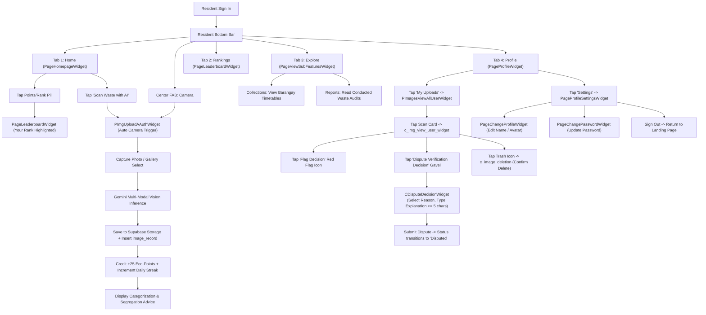

# Resident Access & Navigation Guide

## 1. User Persona & Scope

The **Resident** tier (`UserRole.resident`) represents verified community members who have registered and confirmed their email addresses. Residents have full access to EBasura's gamified recycling platform: they scan waste using the Gemini-powered AI classifier, earn recycling points and streaks, unlock badges, dispute misclassified or wrongly verified images, view their personal upload archives, and monitor barangay garbage collection schedules.

---

## 2. Complete List of Accessible Features

| Feature ID | Screen / Component Name | Route Path | Primary Purpose |
| :--- | :--- | :--- | :--- |
| **RES-01** | `PageHomepageWidget` | `/` or `/pageHomepage` | Authenticated community dashboard with personal greeting, points/rank badge, and next pickup alert. |
| **RES-02** | `PImgUploadAAuthWidget` | `/pImgUploadAAuth` | Authenticated AI Waste Scanner with automatic camera trigger, Gemini analysis, and points rewards. |
| **RES-03** | `PImagesViewAllUserWidget` | `/pImagesViewAllUser` | Personal timeline and gallery of all waste scans uploaded by the user with moderation badges. |
| **RES-04** | `c_img_view_user_widget` | Modal Sheet / Detail | Full-screen inspection of personal scan: AI breakdown, flag toggle, and dispute appeal trigger. |
| **RES-05** | `CDisputeDecisionWidget` | Bottom Sheet Dialog | Formal dispute appeal modal allowing residents to contest wrong AI or verifier classifications. |
| **RES-06** | `c_image_deletion` | Confirmation Dialog | Secure deletion dialog to permanently delete a personal scan. |
| **RES-07** | `PageLeaderboardWidget` | `/pageLeaderboard` | Full interactive community leaderboard displaying top recyclers, rank podium, and user's standing. |
| **RES-08** | `PDatesViewAllWidget` | `/pDatesViewAll` | Barangay collection calendar and list of upcoming pickup dates per street. |
| **RES-09** | `PDatesViewOneWidget` | `/pDatesViewOne` | Specific collection date details, pickup hours, and assigned truck crew. |
| **RES-10** | `PStreetViewOneWidget` | `/pStreetViewOne` | Street directory profile displaying designated pickup windows and guidelines. |
| **RES-11** | `PageViewSubFeaturesWidget` | `/pageViewSubFeatures` | Sub-features discovery directory covering collection schedules and conducted waste audit reports. |
| **RES-12** | `PageProfileWidget` | `/pageProfile` | User profile overview with point totals, unlocked badges, scan counts, and streak tracking. |
| **RES-13** | `PageProfileSettingsWidget` | `/pageProfileSettings` | Account settings hub containing profile modification, credentials, and about links. |
| **RES-14** | `PageChangeProfileWidget` | `/pageChangeProfile` | Form to edit display name, profile avatar, and contact details. |
| **RES-15** | `PageChangeEmailWidget` | `/pageChangeEmail` | Form to update registered email address with OTP confirmation. |
| **RES-16** | `PageChangePasswordWidget` | `/pageChangePassword` | Form to update account password with validation guards. |
| **RES-17** | `PageProfileAboutWidget` | `/pageProfileAbout` | About EBasura mission and background. |
| **RES-18** | `PageProfileAboutADETWidget` | `/pageProfileAboutADET` | Institutional project background and development credits. |
| **RES-19** | `PageProfileAboutResearchWidget` | `/pageProfileAboutResearch` | Technical and ethical research context on computer vision waste characterization. |
| **RES-20** | `TermsAndConditionsWidget` | `/termsAndConditions` | Application terms of use and data privacy agreement. |

---

## 3. Visual Screen Inventory ("What You See")

### 3.1 Resident Bottom Navigation Bar
When authenticated as a resident, `CBottomBarWidget` displays a 4-tab bar tailored for community participation with an elevated center camera button:
```
[ 🏠 Home ]   [ 🏆 Rankings ]   [ 📷 Camera ]   [ 🧭 Explore ]   [ 👤 Profile ]
```

### 3.2 Resident Homepage (`PageHomepageWidget`)
Upon opening the application as an authenticated resident:
1. **Header Section**:
   - User profile avatar.
   - Personalized greeting: *"Hello, [Your Display Name]"*.
   - **Interactive Points & Rank Badge Pill** in the top-right corner displaying your current community rank and total points (tap to jump to Leaderboard).
2. **Hero Countdown Card ("NEXT COLLECTION PICKUP")**:
   - Circular mint icon with truck symbol (`Icons.local_shipping_rounded`).
   - Street name and upcoming pickup countdown.
3. **Primary Action**:
   - Ocean Blue Pill Button 2: **"Scan Waste with AI"** (`Icons.photo_camera_rounded`).
4. **Recent Collections Feed**:
   - List of upcoming barangay pickup schedules with a *"View All"* link.

### 3.3 Profile Screen (`PageProfileWidget`)
Upon tapping Tab 5 (**Profile**):
- **User Identity Card**: Avatar image, display name, registered email address.
- **Metrics Row**: Three distinct statistical cards:
  - **Total Points** (e.g., `1,250 Pts`)
  - **Daily Streak** (e.g., `5 Days 🔥`)
  - **Total Scans** (e.g., `42 Scans`)
- **Badges Showcase**: Grid of earned badges (with vibrant colors and gold borders) vs. locked badges.
- **Action Buttons**:
  - Button 1 (Pill): **"My Uploads"** $\to$ opens your personal scan archive.
  - Button 2 (Pill): **"Settings"** $\to$ opens account management options.
  - Red Sign-Out Tile at the bottom.

### 3.4 Personal Uploads Archive (`PImagesViewAllUserWidget`)
Upon tapping **"My Uploads"**:
- Reverse-chronological photo grid of all your uploaded waste items.
- Status badges overlaid on each card:
  - `Verified` (Green badge with checkmark)
  - `Unsegregated` (Orange/Amber badge)
  - `Flagged` (Red badge with flag icon)
  - `Disputed` (Amber hourglass badge)

### 3.5 Personal Image Detail & Dispute Modal (`c_img_view_user_widget`)
Upon tapping any photo in My Uploads:
- High-resolution photograph with zoom capability.
- AI classification breakdown (material type, recyclability, confidence score).
- **Flag Decision Button**: Quick red flag toggle if the scan was miscategorized.
- **"Dispute Verification Decision" Button** (gavel icon): Visible when an item was flagged, rejected, or unsegregated.
- **Delete Button** (trash icon): Opens deletion confirmation dialog.

### 3.6 Explore Directory (`PageViewSubFeaturesWidget`)
Upon tapping Tab 4 (**Explore**):
- Two segmented tabs: **Collections** (all street schedules) and **Reports** (read-only completed community waste audits).

---

## 4. Interactive Controls Inventory ("What You Use")

| Component / Button | Location | Action Triggered |
| :--- | :--- | :--- |
| **Points & Rank Badge Pill** | Homepage (Top Right) | Deep-links directly to `PageLeaderboardWidget` with your position highlighted. |
| **"Scan Waste with AI" Button** | Homepage | Opens `PImgUploadAAuthWidget` with automatic camera shutter launch. |
| **Center Camera FAB** | Bottom Bar | Opens `PImgUploadAAuthWidget` with automatic camera shutter launch. |
| **"Upcoming Collection" Card** | Homepage | Opens `PDatesViewAllWidget` to inspect all collection schedules. |
| **Rankings Tab** | Bottom Bar | Opens interactive community leaderboard (`PageLeaderboardWidget`). |
| **Explore Tab** | Bottom Bar | Opens `PageViewSubFeaturesWidget` (Collections & Completed Audits). |
| **Profile Tab** | Bottom Bar | Opens `PageProfileWidget` (Stats, Badges, Uploads, Settings). |
| **"My Uploads" Button** | `PageProfileWidget` | Opens `PImagesViewAllUserWidget` photo archive. |
| **Image Card Tap** | `PImagesViewAllUserWidget` | Opens `c_img_view_user_widget` inspection modal. |
| **"Flag Decision" Icon** | `c_img_view_user_widget` | Toggles status to `'Flagged'` to contest automated decision. |
| **"Dispute Verification Decision"** | `c_img_view_user_widget` | Opens `CDisputeDecisionWidget` appeal modal bottom sheet. |
| **"Submit Dispute" Button** | `CDisputeDecisionWidget` | Submits formal dispute appeal; sets status to `'Disputed'` for verifier review. |
| **Delete Icon (Trash)** | `c_img_view_user_widget` | Opens `c_image_deletion` to permanently delete your scan. |
| **"Settings" Button** | `PageProfileWidget` | Opens `PageProfileSettingsWidget`. |
| **Edit Profile Tile** | `PageProfileSettingsWidget` | Opens `PageChangeProfileWidget` to update display name or avatar. |
| **Change Password Tile** | `PageProfileSettingsWidget` | Opens `PageChangePasswordWidget` to securely update credentials. |
| **Sign Out Tile** | `PageProfileSettingsWidget` | Clears local session tokens and returns to `LandingPageWidget`. |

---

## 5. End-to-End User Flow & Navigation Journey



---

## 6. Resident Data Persistence & Supabase Integration

Resident actions trigger automated database updates across Supabase tables:

| Resident Action | Supabase Target Table | Operations Performed |
| :--- | :--- | :--- |
| **AI Waste Scan** | `image_record`, `waste_item`, `user` | Uploads image to Supabase Storage (`waste-images/`), inserts metadata, appends points to `user.user_pts`, increments `user.user_streak`. |
| **Badge Qualification** | `badge_record`, `badge_award` | Evaluates eligibility conditions (e.g., 50 scans, 7-day streak) and links new badge. |
| **Dispute / Flag Submission** | `image_record` | Updates row: `status = 'Flagged'`, `verification_status = 'disputed'`, sets `remark = '[DISPUTE - Category]: Reason'`. |
| **Scan Deletion** | `image_record`, `waste_item` | Deletes image record from database and removes asset from Supabase Storage. |
| **Profile Edits** | `user` | Updates `display_name`, `avatar_url`, or `phone_number`. |

---

> [!NOTE]
> **Community Incident Reporting Status**
> In the current application release, the creation form for waste incident reports (`CReportCreationWidget`) is embedded inside `PReportViewAllWidget`, which is accessed via the **Collection Crew** bottom bar and the **Administrator** dashboard. On the Resident side, the Explore tab (`PageViewSubFeaturesWidget`) provides read-only visibility into conducted waste audits.
