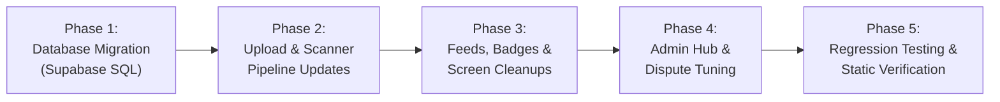

# EBasura Image Category Tri-State Transition Specification

> **Document Status**: Canonical Architecture & Transition Specification  
> **Target Version**: v2.1.0  
> **Sprint Backlog References**:  
> - `[EBASURA-M4-F0]` (User Personal Upload History)  
> - `[EBASURA-M4-F1]` (Public Waste Feed & Dual Tab Gallery)  
> - `[EBASURA-M4-F2]` (Verifier Inspection & Ground-Truth Audit)  
> - `[EBASURA-M4-F3]` (Category Filter Hub & Feeds Consolidation)  
> - `[EBASURA-M4-F4]` (Flagged & Quarantined Moderation Queue)  
> - `[EBASURA-M9-F5]` (Admin Filtered Images Hub)  
> - `[EBASURA-M0-F2]` (Supabase Relational Database & Migrations)  
> **Design Authority**: [`docs/brand_and_design_system.md`](brand_and_design_system.md)  
> **Module Source**: [`docs/modules/module-4-image-records-moderation/README.md`](modules/module-4-image-records-moderation/README.md)

---

## 1. Executive Summary & Purpose

This specification defines the transition of the **EBasura** waste image classification and moderation system from a legacy, fragmented multi-state model into a strict, canonical **Tri-State Lifecycle**:

$$\text{Image Status} \in \{\text{Non-Verified}, \text{Verified}, \text{Flagged}\}$$

### 1.1 The Core Architectural Principle
A major flaw in the legacy design was mixing **verification lifecycle states** with **physical waste attributes** inside the single column `Image.status`.

Under the new architecture:
- **`Image.status`** is reserved exclusively for the **administrative workflow / moderation state** (`Non-Verified`, `Verified`, `Flagged`).
- **Physical waste characteristics** are tracked solely through dedicated, independent boolean columns (`isSegregated`, `category_recycling`, `category_biode`, `category_nonbiode`).

```
+---------------------------------------------------------------------------------------------------+
|                                 DATABASE ROW: 'Image' TABLE                                       |
+---------------------------------------------------------------------------------------------------+
|                                                                                                   |
|   1. MODERATION LIFECYCLE (Column: status)                                                        |
|      ------------------------------------------------------------------------------------------   |
|      • Non-Verified : Ingested from resident upload; pending official verifier audit.            |
|      • Verified     : Audited & approved by official; community points finalized.                 |
|      • Flagged      : Quarantined for prompt injection, fraud, invalid non-waste, or reports.     |
|                                                                                                   |
|   2. PHYSICAL WASTE ATTRIBUTES (Boolean Columns - Independent of Status)                          |
|      ------------------------------------------------------------------------------------------   |
|      • isSegregated       : true (single stream/properly isolated) | false (mixed refuse)         |
|      • category_recycling : true (plastics, metals, glass, paper)  | false                        |
|      • category_biode     : true (organics, food scraps, yard)     | false                        |
|      • category_nonbiode  : true (styrofoam, electronics, rubber)  | false                        |
|                                                                                                   |
|   3. DISPUTE SUB-STATE (Metadata & Remarks)                                                       |
|      ------------------------------------------------------------------------------------------   |
|      • remark             : Tagged with '[DISPUTE - category]: explanation'                       |
|      • allowFlagging      : true (eligible for resident flag/dispute) | false                     |
+---------------------------------------------------------------------------------------------------+
```

---

## 2. Legacy Audit vs. Tri-State Target

### 2.1 Before vs. After Mapping

| Legacy Status Value | Destination Tri-State Value | Transition Rule & Rationale |
| :--- | :--- | :--- |
| `'Categorized by Ai'` | **`Non-Verified`** | Resident AI-assisted scan waiting for official verifier review. |
| `'Uncategorized'` | **`Non-Verified`** | Manual scan or scan where AI classification was incomplete. |
| `'Pending'` | **`Non-Verified`** | Legacy alias for pending review. |
| `'Verified'` | **`Verified`** | Audited by verifier/official; points credited. Preserved as-is. |
| `'Flagged'` | **`Flagged`** | Quarantined for prompt injection, non-waste, or spam. Preserved as-is. |
| `'Segregated'` | **`Verified`** or **`Non-Verified`** | Migrate: `isSegregated` is set to `true`. Record is mapped to `Verified` (if already reviewed) or `Non-Verified`. |
| `'Unsegregated'` | **`Non-Verified`** | Migrate: `isSegregated` is set to `false`. Record is mapped to `Non-Verified` pending verifier review. |
| `'Disputed'` | **`Flagged`** | Preserves primary status as `Flagged` with dispute context stored in `remark` (`[DISPUTE - <category>]: <reason>`). |

---

## 3. Detailed Specifications for the 3 Canonical States

### 3.1 Non-Verified
- **Definition**: The universal intake state for all new submissions uploaded by residents.
- **Visual Design Identity**:
  - Color Token: `#E65100` (Deep Amber / Orange)
  - Icon: `Icons.hourglass_top_rounded`
  - Pill Badge: *"Non-Verified"*
- **User Experience**:
  - Visible in the resident's personal history with an amber hourglass badge.
  - Visible in the public community feed under the **Non-Verified** tab.
  - Residents see predicted AI tags as preliminary guidance, with a clear note that barangay points are pending verifier confirmation.
- **Verifier Action**:
  - Verifiers open the audit screen ([`p_img_view_verifier_widget.dart`](file:///c:/BiboyStuffs/EBasura/lib/image/image_views/p_img_view_verifier/p_img_view_verifier_widget.dart)).
  - Verifier audits classification tags and taps **Verify** (moves to `Verified`) or **Flag** (moves to `Flagged`).

### 3.2 Verified
- **Definition**: Officially inspected, ground-truth confirmed waste records.
- **Visual Design Identity**:
  - Color Token: `#2E7D32` / `#31A11F` (Eco Green)
  - Icon: `Icons.verified_rounded` or `FontAwesomeIcons.checkDouble`
  - Pill Badge: *"Verified"*
- **User Experience**:
  - Final state; user points are credited to `user_subtable.user_points`.
  - Promoted to public community records and collection schedules.
  - Cannot be flagged by normal residents (`allowFlagging = false`).

### 3.3 Flagged
- **Definition**: Quarantined submissions violating platform guidelines (prompt injection attacks, non-waste photos, duplicate spam, or improper disposal).
- **Visual Design Identity**:
  - Color Token: `#C44545` (Warning Red)
  - Icon: `Icons.flag_rounded`
  - Pill Badge: *"Flagged"*
- **Automated Quarantine**:
  - If the Gemini AI evaluation detects prompt injection or invalid waste (`valid_waste_image == false`), the scanning pipeline automatically routes the upload to `status = 'Flagged'`.
  - Quarantine hides the image from the general community public feed, keeping it accessible only to the uploader and authorized verifiers/admins.
- **Dispute Appeal Flow**:
  - Residents who believe an image was incorrectly flagged can tap **Dispute Decision** in [`c_img_view_user_widget.dart`](file:///c:/BiboyStuffs/EBasura/lib/image/image_views/c_img_view_user/c_img_view_user_widget.dart#L1006).
  - The dispute sheet ([`c_dispute_decision_widget.dart`](file:///c:/BiboyStuffs/EBasura/lib/image/c_dispute_decision/c_dispute_decision_widget.dart)) appends the appeal reason to `Image.remark` (`[DISPUTE - <category>]: <reason>`) without introducing a conflicting primary status.

---

## 4. Supabase Database Migration Plan

Execute the following idempotent SQL migration script in the Supabase SQL Editor:

```sql
-- ============================================================================
-- EBasura Database Migration: Tri-State Image Status Consolidation
-- ============================================================================

BEGIN;

-- 1. Backfill legacy AI and uncategorized rows to Non-Verified
UPDATE "Image"
SET "status" = 'Non-Verified'
WHERE "status" IN ('Categorized by Ai', 'Uncategorized', 'Pending') 
   OR "status" IS NULL;

-- 2. Backfill legacy Segregated status
UPDATE "Image"
SET "isSegregated" = true,
    "status" = 'Verified'
WHERE "status" = 'Segregated';

-- 3. Backfill legacy Unsegregated status
UPDATE "Image"
SET "isSegregated" = false,
    "status" = 'Non-Verified'
WHERE "status" = 'Unsegregated';

-- 4. Backfill legacy Disputed status to Flagged with dispute annotation
UPDATE "Image"
SET "status" = 'Flagged',
    "remark" = COALESCE("remark" || ' ', '') || '[DISPUTE PENDING AUDIT]'
WHERE "status" = 'Disputed';

-- 5. Set default column value to 'Non-Verified'
ALTER TABLE "Image" 
ALTER COLUMN "status" SET DEFAULT 'Non-Verified';

-- 6. Add check constraint to enforce strictly the 3 canonical states
ALTER TABLE "Image" 
DROP CONSTRAINT IF EXISTS chk_image_tri_state_status;

ALTER TABLE "Image" 
ADD CONSTRAINT chk_image_tri_state_status 
CHECK ("status" IN ('Non-Verified', 'Verified', 'Flagged'));

COMMIT;
```

---

## 5. Codebase Component Transition Guide

### 5.1 Scanning Upload Pipeline (`lib/image/image_uploads/p_img_upload_a_auth/`)
In [`p_img_upload_a_auth_widget.dart`](file:///c:/BiboyStuffs/EBasura/lib/image/image_uploads/p_img_upload_a_auth/p_img_upload_a_auth_widget.dart):
- **Line 199 (Resident Auto Pipeline)**:
  - Replace `'status': 'Categorized by Ai'` with:
    ```dart
    'status': _model.checkboxValidityValue == false ? 'Flagged' : 'Non-Verified',
    ```
  - Auto-flags prompt injection or invalid waste scans, logging a quarantine remark:
    ```dart
    'remark': _model.checkboxValidityValue == false 
        ? 'Auto-quarantined: Prompt injection or invalid waste detected by Gemini AI'
        : null,
    ```
- **Line 967 (Manual Upload)**:
  - Replace `'status': 'Uncategorized'` with `'status': 'Non-Verified'`.
- **Line 2314 (Admin Direct Upload)**:
  - Retain `'status': 'Verified'`.

### 5.2 Filter Hub & Screen Consolidation (`lib/image/image_filtered/`)
The 6 legacy wrapper screens in [`lib/image/image_filtered/`](file:///c:/BiboyStuffs/EBasura/lib/image/image_filtered/) are streamlined:

| Screen File | Route Path | New Implementation |
| :--- | :--- | :--- |
| `p_images_view_all_ai_widget.dart` | `/pImagesViewAllAi` | Delegates to `PImagesViewAllWidget(initialStatus: 'Non-Verified')` (route backwards alias). |
| `p_images_view_all_uncategorized_widget.dart` | `/pImagesViewAllUncategorized` | Delegates to `PImagesViewAllWidget(initialStatus: 'Non-Verified')` (route backwards alias). |
| `p_images_view_all_segregated_widget.dart` | `/pImagesViewAllSegregated` | Delegates to `PImagesViewAllWidget(initialStatus: 'Non-Verified')` with segregated attribute toggle. |
| `p_images_view_all_unsegregated_widget.dart` | `/pImagesViewAllUnsegregated` | Delegates to `PImagesViewAllWidget(initialStatus: 'Non-Verified')`. |
| `p_images_view_all_verified_widget.dart` | `/pImagesViewAllVerified` | Delegates to `PImagesViewAllWidget(initialStatus: 'Verified')`. |
| `p_images_view_all_flagged_widget.dart` | `/pImagesViewAllFlagged` | Delegates to `PImagesViewAllWidget(initialStatus: 'Flagged')`. |

### 5.3 Admin Category Hub (`lib/admin/page_filtered_images/page_filtered_images_widget.dart`)
Replace the 6 legacy rows with 3 high-contrast, modern navigation tiles matching the Brand System:
1. **Non-Verified Queue**:
   - Icon: `Icons.hourglass_top_rounded` (`#E65100`)
   - Route: `PImagesViewAllWidget(initialStatus: 'Non-Verified')`
   - Description: *"Resident submissions awaiting community verifier inspection"*
2. **Verified Records**:
   - Icon: `Icons.verified_rounded` (`#2E7D32`)
   - Route: `PImagesViewAllWidget(initialStatus: 'Verified')`
   - Description: *"Audited and confirmed community waste records"*
3. **Flagged & Quarantined**:
   - Icon: `Icons.flag_rounded` (`#C44545`)
   - Route: `PImagesViewAllWidget(initialStatus: 'Flagged')`
   - Description: *"Quarantined images, prompt injections, and disputed uploads"*

### 5.4 Main Community Feed (`lib/image/image_views/p_images_view_all/`)
In [`p_images_view_all_widget.dart`](file:///c:/BiboyStuffs/EBasura/lib/image/image_views/p_images_view_all/p_images_view_all_widget.dart):
- **Dual Tab Header**:
  - Tab 0: **Non-Verified** (`#E65100`)
  - Tab 1: **Verified** (`#2E7D32`)
- **Quick Filter Chips**:
  - Status chips: `All`, `Non-Verified`, `Verified`, `Flagged`
  - Attribute chips: `Recyclable` (`category_recycling == true`), `Biodegradable` (`category_biode == true`), `Segregated` (`isSegregated == true`).
- **Postgres Stream Query**:
  - Filter by `status` matching `_model.dropDownStatusValue` (`Non-Verified`, `Verified`, `Flagged`, or `null` for `All`).
- **Card Badges**:
  - Clean 3-way conditional badge:
    ```dart
    if (item.status == 'Verified') ...[
      // Green Verified Badge
    ] else if (item.status == 'Flagged') ...[
      // Red Flagged Badge
    ] else ...[
      // Orange Non-Verified Badge
    ]
    ```

### 5.5 Personal Upload History (`lib/image/image_views/p_images_view_all_user/`)
In [`p_images_view_all_user_widget.dart`](file:///c:/BiboyStuffs/EBasura/lib/image/image_views/p_images_view_all_user/p_images_view_all_user_widget.dart#L487-L545):
- Consolidate icon rendering to 3 branches:
  ```dart
  if (staggeredViewImageRow.status == 'Verified')
    FaIcon(FontAwesomeIcons.checkDouble, color: Color(0xFF2E7D32), size: 20.0),
  if (staggeredViewImageRow.status == 'Flagged')
    Icon(Icons.flag_rounded, color: Color(0xFFC44545), size: 20.0),
  if (staggeredViewImageRow.status == 'Non-Verified')
    Icon(Icons.hourglass_top_rounded, color: Color(0xFFE65100), size: 20.0),
  ```

### 5.6 Verifier Inspection Screen (`lib/image/image_views/p_img_view_verifier/`)
In [`p_img_view_verifier_widget.dart`](file:///c:/BiboyStuffs/EBasura/lib/image/image_views/p_img_view_verifier/p_img_view_verifier_widget.dart):
- Display status pill: `Non-Verified` (Pending), `Verified`, or `Flagged`.
- Audit actions:
  - **Verify Button**: Updates `status = 'Verified'`, calculates and credits gamification points.
  - **Flag Button**: Updates `status = 'Flagged'`, revokes points if previously granted, sets `allowFlagging = false`.

### 5.7 Dispute Flow (`lib/image/c_dispute_decision/`)
In [`c_dispute_decision_widget.dart`](file:///c:/BiboyStuffs/EBasura/lib/image/c_dispute_decision/c_dispute_decision_widget.dart#L82-L93):
- Maintain primary status as `'Flagged'`.
- Append dispute details to `remark`:
  ```dart
  await ImageTable().update(
    data: {
      'status': 'Flagged',
      'remark': '[DISPUTE - ${_model.selectedDisputeCategory}]: $reasonText',
      'updated_by': currentUserUid,
      'updated_at': DateTime.now().toIso8601String(),
    },
    matchingRows: (rows) => rows.eq('image_id', imageId),
  );
  ```

---

## 6. Implementation Plan & Execution Phases



### Phase 1: Database Migration
1. Execute SQL migration in Supabase to backfill all legacy rows to `Non-Verified`, `Verified`, and `Flagged`.
2. Apply `DEFAULT 'Non-Verified'` and check constraint.

### Phase 2: Scanner Upload Pipeline
1. Update [`p_img_upload_a_auth_widget.dart`](file:///c:/BiboyStuffs/EBasura/lib/image/image_uploads/p_img_upload_a_auth/p_img_upload_a_auth_widget.dart):
   - Set resident auto-scans to `'Non-Verified'`.
   - Set prompt-injected or invalid scans to `'Flagged'` with audit remarks.
   - Set manual uploads to `'Non-Verified'`.

### Phase 3: Feed, Badge & Stream Cleanups
1. Update [`p_images_view_all_widget.dart`](file:///c:/BiboyStuffs/EBasura/lib/image/image_views/p_images_view_all/p_images_view_all_widget.dart) filters, tabs, and card badges.
2. Update [`p_images_view_all_user_widget.dart`](file:///c:/BiboyStuffs/EBasura/lib/image/image_views/p_images_view_all_user/p_images_view_all_user_widget.dart) status icons.
3. Update [`p_img_view_verifier_widget.dart`](file:///c:/BiboyStuffs/EBasura/lib/image/image_views/p_img_view_verifier/p_img_view_verifier_widget.dart) verification buttons and headers.

### Phase 4: Admin Hub & Dispute Tuning
1. Redesign [`page_filtered_images_widget.dart`](file:///c:/BiboyStuffs/EBasura/lib/admin/page_filtered_images/page_filtered_images_widget.dart) into 3 high-contrast navigation tiles.
2. Update [`c_dispute_decision_widget.dart`](file:///c:/BiboyStuffs/EBasura/lib/image/c_dispute_decision/c_dispute_decision_widget.dart) to retain `status = 'Flagged'` with dispute remarks.
3. Align report queries in [`page_view_sub_features_widget.dart`](file:///c:/BiboyStuffs/EBasura/lib/page_view_sub_features/page_view_sub_features_widget.dart).

### Phase 5: Verification & Testing
1. Run `flutter analyze` to ensure 0 static errors.
2. Verify route navigation for `/pImagesViewAll`, `/pImagesViewAllVerified`, `/pImagesViewAllFlagged`, `/pImagesViewAllAi`.
3. Validate visual token consistency against [`docs/brand_and_design_system.md`](brand_and_design_system.md).
