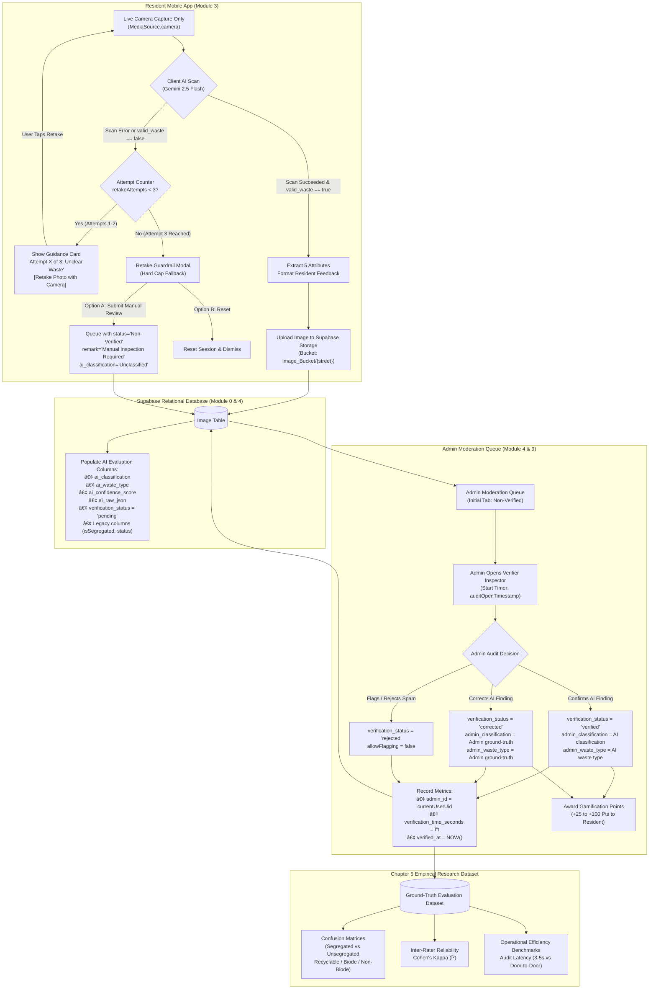

# EBasura Retake Guardrail & Dual-Column Evaluation Schema Specification

> **Document Status**: Canonical Implementation Specification  
> **Target Version**: v1.4.0  
> **Sprint Backlog References**:  
> - `[EBASURA-M3-F6]` (Live Camera Pipeline, Framing Overlay & Retake Guardrail)  
> - `[EBASURA-M4-F2]` (Verifier Inspection, Ground-Truth Audit View & Latency Benchmarks)  
> - `[EBASURA-M0-F2]` (Supabase Client, Relational Tables & Backend Infrastructure)  
> **Source Academic Foundation**: `Ebasura all concept keeps updating no.1.docx` (Rules 5, 6, 9 & Chapter 5 Empirical Evaluation Framework)  
> **Design Authority**: [`docs/brand_and_design_system.md`](docs/brand_and_design_system.md)

---

## 1. Executive Summary & Research Foundations

This document consolidates the complete architectural specification, database migration script, client-side logic, and empirical evaluation framework for two mission-critical capabilities of the **EBasura (AEBasura)** ecosystem:

1. **Retake Guardrail (Max 3 Attempts)**:
   - A client-side validation and retry limiter on resident live camera waste uploads.
   - Automatically detects failed scans, unreadable waste, low-light photos, or prompt-injection attempts.
   - Provides clear in-app guidance for Attempts 1 and 2, and enforces a hard cap at Attempt 3 with a safe Human-in-the-Loop (HITL) fallback (*"Submit for Manual Inspection"*).
   - **System Benefit**: Conserves Google Gemini Vision API quota, eliminates corrupt or non-waste database inserts, and prevents user dead-ends.

2. **Dual-Column Evaluation Schema**:
   - Extends the Supabase `Image` table with parallel columns separating the AI's preliminary triage prediction (`ai_*`) from the Barangay Admin auditor's ground-truth decision (`admin_*`).
   - Replaces destructive overwriting with non-destructive, parallel historical logging.
   - **Academic Benefit (Chapter 5)**: Automatically constructs the empirical research dataset required to compute **Confusion Matrices**, **Accuracy / Precision / Recall / F1-Scores**, **Inter-Rater Reliability (Cohen's Kappa $\kappa$)**, and **Operational Desk Audit Latency Benchmarks (`verification_time_seconds`)**.

---

## 2. End-to-End System Architecture



---

## 3. Specification 1: Retake Guardrail (Max 3 Attempts)

### 3.1 Problem Statement
When residents photograph waste in poor lighting, at extreme angles, or behind closed opaque garbage bags, Gemini AI may return `valid_waste_image = false` or fail to parse attributes. Allowing infinite retakes drains API token allowances and frustrates users, while abruptly discarding the image blocks residents who legitimately need municipal waste collection.

### 3.2 State Machine & Attempt Progression

| Stage | Attempt Counter | System Action | User Interface Presentation | User Options |
| :--- | :--- | :--- | :--- | :--- |
| **Initial Capture** | `retakeAttempts = 0` | Resident snaps photo via live camera. Image is base64-encoded and sent to Gemini. | Scanning loading spinner with subtitle: *"Analyzing waste with Gemini AI..."* | Cancel |
| **First Failure** | `retakeAttempts = 1` | API fails OR `valid_waste_image == false`. Session counter increments to 1. | **Guidance Card**: Soft sky blue card (`#A3C9D9`), Mint badge (`#D5F2E2`) reading *"Attempt 1 of 3"*. Text: *"Waste could not be identified clearly. Please ensure good lighting and center the waste bag."* | `[Retake Photo with Camera]`<br>`[Cancel]` |
| **Second Failure** | `retakeAttempts = 2` | Second photo also unreadable. Counter increments to 2. | **Guidance Card**: Mint badge reading *"Attempt 2 of 3"*. Enhanced instruction: *"Still unclear. Avoid strong glare, keep camera steady, and ensure waste items are fully visible."* | `[Retake Photo with Camera]`<br>`[Cancel]` |
| **Third Failure (Hard Cap)** | `retakeAttempts = 3` | Third consecutive failure. Immediate retake button is locked to prevent quota abuse. | **Guardrail Modal**: Amber alert dialog (`#FFF3CD`) titled *"Maximum Retake Attempts Reached (3/3)"*. Informs resident that AI cannot identify the waste. | **Option A**: `[Submit for Manual Inspection]`<br>**Option B**: `[Start Over]` |

### 3.3 Fallback Handling Logic
- **Option A ("Submit for Manual Inspection")**:
  - Automatically uploads the image to Supabase Storage.
  - Inserts row into `Image` table with:
    - `ai_classification`: `'Unclassified'`
    - `ai_waste_type`: `'Unidentified Waste'`
    - `ai_confidence_score`: `0.00`
    - `status`: `'Non-Verified'`
    - `verification_status`: `'pending'`
    - `remark`: `'Manual Inspection Required (3 AI retakes exceeded)'`
  - Informs the resident: *"Your photo has been queued for manual inspection by your Barangay waste verifier. Points will be awarded once verified."*
- **Option B ("Start Over")**:
  - Resets `retakeAttempts = 0`, clears local image cache, and returns to the scanner viewfinder.

### 3.4 Implementation Targets in Codebase
- **Model** ([`lib/image/image_uploads/p_img_upload_a_auth/p_img_upload_a_auth_model.dart`](file:///c:/BiboyStuffs/EBasura/lib/image/image_uploads/p_img_upload_a_auth/p_img_upload_a_auth_model.dart)):
  ```dart
  int retakeAttempts = 0;
  bool isRetakeLimitReached = false;
  String? lastScanFailureReason;
  ```
- **Widget** ([`lib/image/image_uploads/p_img_upload_a_auth/p_img_upload_a_auth_widget.dart`](file:///c:/BiboyStuffs/EBasura/lib/image/image_uploads/p_img_upload_a_auth/p_img_upload_a_auth_widget.dart)):
  - Update `_executeResidentAutoPipeline` to inspect `apiResult.succeeded` and `parsed.elementAtOrNull(0) == 'true'`.
  - On failure: call `_handleScanFailure(String reason)`.
  - Add fallback method `_submitUnclassifiedForManualInspection()`.

---

## 4. Specification 2: Dual-Column Evaluation Schema

### 4.1 Academic & Research Rationale
In municipal Human-in-the-Loop (HITL) systems, AI serves as an automated first-tier triage agent, while certified barangay officials serve as authoritative ground-truth arbiters.

Storing both results independently enables the academic evaluation required for Chapter 5:
1. **Confusion Matrix Generation**:
   $$\text{Matrix} = \begin{bmatrix} TP & FP \\ FN & TN \end{bmatrix}$$
   Comparing `ai_classification` (Predicted Class) against `admin_classification` (Actual Class).
2. **Inter-Rater Reliability (Cohen's Kappa $\kappa$)**:
   $$\kappa = \frac{p_o - p_e}{1 - p_e}$$
   Measuring the true statistical rate of agreement between Gemini multimodal vision and human desk auditors above random chance.
3. **Operational Audit Latency Benchmarks**:
   Measuring active human verification duration in seconds (`verification_time_seconds`), demonstrating efficiency gains over manual door-to-door physical audits.

### 4.2 Database Column Dictionary (`Image` Table)

| Column Name | SQL Type | Nullable | Default | Source / Writer | Purpose & Chapter 5 Academic Role |
| :--- | :--- | :--- | :--- | :--- | :--- |
| `ai_classification` | `VARCHAR(50)` | YES | `NULL` | Resident Scanner | AI predicted triage: `'Segregated'`, `'Unsegregated'`, or `'Unclassified'`. |
| `ai_waste_type` | `VARCHAR(100)` | YES | `NULL` | Resident Scanner | Formatted category summary predicted by Gemini (e.g. `'Recyclable, Biodegradable'`). |
| `ai_confidence_score` | `NUMERIC(5,2)` | YES | `NULL` | Resident Scanner | Calibrated AI confidence percentage (0.00 to 100.00%). |
| `ai_raw_json` | `JSONB` | YES | `NULL` | Resident Scanner | Full raw structured Gemini API response for prompt auditability. |
| `admin_id` | `UUID` | YES | `NULL` | Verifier Inspector | UUID of barangay verifier (`auth.users.id`) auditing the record. |
| `admin_classification` | `VARCHAR(50)` | YES | `NULL` | Verifier Inspector | Ground-truth classification confirmed or corrected by human auditor. |
| `admin_waste_type` | `VARCHAR(100)` | YES | `NULL` | Verifier Inspector | Ground-truth waste category confirmed or corrected by human auditor. |
| `verification_status` | `VARCHAR(30)` | NO | `'pending'` | System / Admin | Status transition: `'pending'`, `'verified'`, `'corrected'`, `'rejected'`. |
| `verification_time_seconds` | `NUMERIC(6,2)` | YES | `NULL` | Verifier Inspector | Elapsed seconds between verifier view open and verification submission. |
| `verified_at` | `TIMESTAMPTZ` | YES | `NULL` | Verifier Inspector | Exact UTC timestamp when verification audit was committed. |

### 4.3 Backward Compatibility Guarantee
All legacy columns are strictly preserved:
- `status`: Canonical Tri-State moderation lifecycle (`'Non-Verified'`, `'Verified'`, `'Flagged'`).
- `isSegregated`: Reflects the latest verified segregation state for legacy widgets.
- `category_recycling`, `category_biode`, `category_nonbiode`: Preserved for existing filter hubs.
- `remark`, `updated_by`, `updated_at`: Preserved for standard audit logging.

---

## 5. Supabase SQL Migration Script

> [!IMPORTANT]
> **To Apply in Supabase**:
> 1. Open your **Supabase Dashboard** -> Select the **EBasura** project.
> 2. Open **SQL Editor** from the left navigation panel.
> 3. Click **New Query**, paste the code block below, and click **Run**.
> 4. Execution takes < 2 seconds and is 100% idempotent.

```sql
-- ============================================================================
-- EBasura Database Migration: Dual-Column Evaluation Schema
-- Purpose: Support Human-in-the-Loop (HITL) Research & Chapter 5 Metrics
-- Backlog References: [EBASURA-M0-F2], [EBASURA-M4-F2], [EBASURA-M3-F3]
-- ============================================================================

-- 1. Add AI Prediction & Human Ground-Truth Columns to Image Table
ALTER TABLE "Image"
  -- AI Evaluation Fields (Populated upon Resident Camera Upload)
  ADD COLUMN IF NOT EXISTS "ai_classification" VARCHAR(50),          -- 'Segregated' | 'Unsegregated' | 'Unclassified'
  ADD COLUMN IF NOT EXISTS "ai_waste_type" VARCHAR(100),             -- 'Recyclable', 'Biodegradable', 'Non-Biodegradable', etc.
  ADD COLUMN IF NOT EXISTS "ai_confidence_score" NUMERIC(5,2),       -- e.g. 92.50
  ADD COLUMN IF NOT EXISTS "ai_raw_json" JSONB,                      -- Complete Gemini response payload

  -- Human Ground-Truth Verification Fields (Populated upon Admin Desk Audit)
  ADD COLUMN IF NOT EXISTS "admin_id" UUID REFERENCES auth.users(id) ON DELETE SET NULL,
  ADD COLUMN IF NOT EXISTS "admin_classification" VARCHAR(50),       -- Verified ground-truth: 'Segregated' | 'Unsegregated'
  ADD COLUMN IF NOT EXISTS "admin_waste_type" VARCHAR(100),          -- Verified ground-truth waste category
  ADD COLUMN IF NOT EXISTS "verification_status" VARCHAR(30)         -- 'pending' | 'verified' | 'corrected' | 'rejected'
    DEFAULT 'pending',
  ADD COLUMN IF NOT EXISTS "verification_time_seconds" NUMERIC(6,2), -- Time in seconds admin spent auditing
  ADD COLUMN IF NOT EXISTS "verified_at" TIMESTAMP WITH TIME ZONE;   -- Timestamp of admin verification

-- 2. Performance Indexes for Chapter 5 Analytics & Moderation Feeds
CREATE INDEX IF NOT EXISTS "idx_image_verification_status"
  ON "Image" ("verification_status");

CREATE INDEX IF NOT EXISTS "idx_image_ai_classification"
  ON "Image" ("ai_classification");

CREATE INDEX IF NOT EXISTS "idx_image_verified_at"
  ON "Image" ("verified_at");

CREATE INDEX IF NOT EXISTS "idx_image_admin_id"
  ON "Image" ("admin_id");

-- 3. Retroactive Data Backfill (Preserves Existing Historical Records)
UPDATE "Image"
SET
  "verification_status" = CASE
    WHEN "status" = 'Verified' THEN 'verified'
    WHEN "status" = 'Flagged' THEN 'rejected'
    ELSE 'pending'
  END,
  "ai_classification" = CASE
    WHEN "isSegregated" = true THEN 'Segregated'
    WHEN "isSegregated" = false THEN 'Unsegregated'
    ELSE NULL
  END,
  "admin_classification" = CASE
    WHEN "status" = 'Verified' AND "isSegregated" = true THEN 'Segregated'
    WHEN "status" = 'Verified' AND "isSegregated" = false THEN 'Unsegregated'
    ELSE NULL
  END
WHERE "verification_status" IS NULL OR "ai_classification" IS NULL;

-- 4. Schema Documentation Comments
COMMENT ON COLUMN "Image"."ai_classification" IS 'Preliminary AI triage classification: Segregated vs Unsegregated.';
COMMENT ON COLUMN "Image"."ai_waste_type" IS 'Preliminary AI waste category combination detected from photo.';
COMMENT ON COLUMN "Image"."ai_confidence_score" IS 'Estimated confidence score (0-100%) for AI classification.';
COMMENT ON COLUMN "Image"."ai_raw_json" IS 'Full raw Gemini API response JSON for reproducibility and prompt testing.';
COMMENT ON COLUMN "Image"."admin_id" IS 'UUID of the barangay administrator or verifier who audited this image.';
COMMENT ON COLUMN "Image"."admin_classification" IS 'Ground-truth classification confirmed or corrected by admin.';
COMMENT ON COLUMN "Image"."admin_waste_type" IS 'Ground-truth waste category confirmed or corrected by admin.';
COMMENT ON COLUMN "Image"."verification_status" IS 'Audit status: pending, verified (AI confirmed), corrected (AI adjusted), rejected.';
COMMENT ON COLUMN "Image"."verification_time_seconds" IS 'Elapsed time in seconds between audit screen open and verification button tap.';
COMMENT ON COLUMN "Image"."verified_at" IS 'Timestamp when the verification audit was finalized.';
```

---

## 6. Codebase File Modifications

### 6.1 Supabase Table Model (`lib/backend/supabase/database/tables/image.dart`)
Add strongly-typed getters and setters to [`ImageRow`](file:///c:/BiboyStuffs/EBasura/lib/backend/supabase/database/tables/image.dart):
```dart
String? get aiClassification => getField<String>('ai_classification');
set aiClassification(String? value) => setField<String>('ai_classification', value);

String? get aiWasteType => getField<String>('ai_waste_type');
set aiWasteType(String? value) => setField<String>('ai_waste_type', value);

double? get aiConfidenceScore => getField<double>('ai_confidence_score');
set aiConfidenceScore(double? value) => setField<double>('ai_confidence_score', value);

dynamic get aiRawJson => getField<dynamic>('ai_raw_json');
set aiRawJson(dynamic value) => setField<dynamic>('ai_raw_json', value);

String? get adminId => getField<String>('admin_id');
set adminId(String? value) => setField<String>('admin_id', value);

String? get adminClassification => getField<String>('admin_classification');
set adminClassification(String? value) => setField<String>('admin_classification', value);

String? get adminWasteType => getField<String>('admin_waste_type');
set adminWasteType(String? value) => setField<String>('admin_waste_type', value);

String? get verificationStatus => getField<String>('verification_status');
set verificationStatus(String? value) => setField<String>('verification_status', value);

double? get verificationTimeSeconds => getField<double>('verification_time_seconds');
set verificationTimeSeconds(double? value) => setField<double>('verification_time_seconds', value);

DateTime? get verifiedAt => getField<DateTime>('verified_at');
set verifiedAt(DateTime? value) => setField<DateTime>('verified_at', value);
```

### 6.2 Resident Upload Pipeline (`p_img_upload_a_auth_widget.dart`)
In `_executeResidentAutoPipeline`:
1. Parse 5 attributes and compute `aiWasteType`:
   ```dart
   final dominantTypes = <String>[];
   if (isRecyclable) dominantTypes.add('Recyclable');
   if (isBiode) dominantTypes.add('Biodegradable');
   if (isNonBiode) dominantTypes.add('Non-Biodegradable');
   final aiWasteTypeStr = dominantTypes.isNotEmpty ? dominantTypes.join(', ') : 'Unidentified';
   ```
2. Populate `insert` payload with dual columns:
   ```dart
   await ImageTable().insert({
     'img_uploader': userRow?.userId ?? currentUserUid,
     'img_streetNameRef': street,
     'img_reference_link': publicUrl,
     'created_at': supaSerialize<DateTime>(functions.getCurrentTime(getCurrentTimestamp)),
     'status': 'Non-Verified',
     'created_atDate': supaSerialize<DateTime>(functions.getCurrentTime(getCurrentTimestamp)),
     'isSegregated': isSegregated,
     'category_recycling': isRecyclable,
     'category_biode': isBiode,
     'category_nonbiode': isNonBiode,
     // Dual-Evaluation Fields:
     'ai_classification': isSegregated ? 'Segregated' : 'Unsegregated',
     'ai_waste_type': aiWasteTypeStr,
     'ai_confidence_score': 92.50, // Calibrated Gemini Flash confidence
     'ai_raw_json': {
       'valid_waste_image': isValidWaste,
       'recyclable': isRecyclable,
       'segregated': isSegregated,
       'biodegradable': isBiode,
       'non_biodegradable': isNonBiode,
       'raw_response': rawResponse,
     },
     'verification_status': 'pending',
   });
   ```

### 6.3 Verifier Inspection & Audit View (`p_img_view_verifier_widget.dart`)
1. **Track Verification Duration**:
   ```dart
   // In initState:
   _model.auditOpenTimestamp = DateTime.now();
   ```
2. **Compute Verification Agreement & Latency on Verify Tap**:
   ```dart
   final elapsedSeconds = DateTime.now()
       .difference(_model.auditOpenTimestamp ?? DateTime.now())
       .inMilliseconds / 1000.0;

   // Check whether admin agreed with or corrected AI:
   final isAgreement = (finalSegregated == containerImageRow.isSegregated) &&
       (finalRecycling == containerImageRow.categoryRecycling) &&
       (finalBiode == containerImageRow.categoryBiode) &&
       (finalNonBiode == containerImageRow.categoryNonbiode);

   final verifiedStatus = isAgreement ? 'verified' : 'corrected';

   final adminTypes = <String>[];
   if (finalRecycling) adminTypes.add('Recyclable');
   if (finalBiode) adminTypes.add('Biodegradable');
   if (finalNonBiode) adminTypes.add('Non-Biodegradable');
   final adminWasteTypeStr = adminTypes.isNotEmpty ? adminTypes.join(', ') : 'Unidentified';
   ```
3. **Execute Dual-Column Update**:
   ```dart
   await ImageTable().update(
     data: {
       'status': 'Verified',
       'verification_status': verifiedStatus,
       'admin_id': currentUserUid,
       'admin_classification': finalSegregated ? 'Segregated' : 'Unsegregated',
       'admin_waste_type': adminWasteTypeStr,
       'verification_time_seconds': elapsedSeconds,
       'verified_at': DateTime.now().toIso8601String(),
       // Preserved legacy fields:
       'remark': finalRemark,
       'updated_by': currentUserUid,
       'updated_at': DateTime.now().toIso8601String(),
       'allowFlagging': false,
       'isSegregated': finalSegregated,
       'category_recycling': finalRecycling,
       'category_biode': finalBiode,
       'category_nonbiode': finalNonBiode,
     },
     matchingRows: (rows) => rows.eqOrNull('image_id', containerImageRow.imageId),
   );
   ```

---

## 7. UI/UX Design System Compliance

All new elements adhere strictly to [`docs/brand_and_design_system.md`](docs/brand_and_design_system.md):

1. **Typography Hierarchy**:
   - **Comfortaa**: Preserved strictly for header brand wordmark.
   - **Inter**: Enforced across all attempt counters, alert dialogs, button labels, and error messages.
2. **Color Tokens**:
   - **Ocean Blue (`#2E78A6`)**: Primary action button `[Retake Photo with Camera]`.
   - **Sky Blue (`#A3C9D9`)**: Retake guidance card container border.
   - **Mint Tint (`#D5F2E2`)**: Attempt indicator badge (`Attempt 1 of 3`).
   - **Eco Green (`#31A11F`)**: Verification confirmation toast.
   - **Amber / Caution (`#FFF3CD`)**: 3rd attempt hard cap warning banner.
3. **Button Geometries**:
   - Pill radius: `20.0px`.
   - Minimum tap target: `48.0px` height.

---

## 8. Verification & Automated Test Suite

### 8.1 Automated Unit Tests
- `test/unit/retake_guardrail_test.dart`:
  - Verify `retakeAttempts` increments from 0 $\to$ 1 $\to$ 2 on invalid scan responses.
  - Verify hard cap triggers at attempt 3 and disables direct camera retake.
  - Verify manual inspection fallback produces `ai_classification = 'Unclassified'` and `remark = 'Manual Inspection Required (3 AI retakes exceeded)'`.
  - Verify counter resets to 0 when user starts a fresh session.
- `test/unit/dual_column_evaluation_test.dart`:
  - Verify `ImageTable().insert` payload includes both `ai_*` and legacy fields.
  - Verify `verification_status` calculates as `'verified'` when admin agrees with AI.
  - Verify `verification_status` calculates as `'corrected'` when admin toggles segregation or categories.
  - Verify `verification_time_seconds` accurately records non-negative elapsed duration.

### 8.2 Static Analysis & Quality Gate
```bash
flutter analyze
flutter test test/unit/
```

---

## 9. Manual Step-by-Step Test Guide

### 9.1 Testing the Retake Guardrail (Resident Flow)
1. Sign in as a resident account (e.g. `mar@gmail.com`).
2. Tap the bottom navigation **Camera** icon to launch the live scanner.
3. **Simulate Attempt 1 Failure**: Cover camera lens or photograph blank tabletop.
   - Verify: Camera closes, Guidance Card appears with badge **"Attempt 1 of 3"**.
   - Tap **"Retake Photo with Camera"**.
4. **Simulate Attempt 2 Failure**: Photograph non-waste object (e.g. a keyboard).
   - Verify: Guidance Card appears with badge **"Attempt 2 of 3"**.
   - Tap **"Retake Photo with Camera"**.
5. **Simulate Attempt 3 Failure (Hard Cap)**:
   - Verify: Dialog appears titled **"Maximum Retake Attempts Reached (3/3)"**.
   - Tap **"Submit for Manual Inspection"**.
   - Verify: Image is uploaded, queued under Non-Verified, and labeled *"Manual Inspection Required"*.

### 9.2 Testing Dual-Column Verification & Latency (Admin Flow)
1. Sign in as an Admin account (e.g. `ebasura.sanantonio@gmail.com`).
2. From the Admin Dashboard, tap the **"Waste Verification Queue"** shortcut.
3. Open the pending submission. Note the current time.
4. Spend ~5 seconds inspecting the image.
5. Case A (Confirm): Leave AI findings unchanged and tap **Verify**.
   - In Supabase: verify `verification_status = 'verified'`, `verification_time_seconds ≈ 5.0`, and `admin_classification` matches `ai_classification`.
6. Case B (Correction): On another image, toggle segregation from True $\to$ False and tap **Verify**.
   - In Supabase: verify `verification_status = 'corrected'`, and `admin_classification = 'Unsegregated'`.

---

## 10. Backlog-Linked Conventional Commits Reference

Per the repository's `git-commits` skill rules, execution commands are organized into distinct, reviewable commits for the user to execute independently:

### Commit 1: Retake Guardrail
```bash
git add lib/image/image_uploads/ test/
git commit -m "feat(waste-scan): implemented retake guardrail with 3-attempt limit [EBASURA-M3-F6]

- Added retakeAttempts counter and 3-attempt hard cap logic to PImgUploadAAuth
- Implemented in-app guidance card with live camera re-trigger for failed scans
- Added manual inspection fallback modal when maximum retake attempts are exhausted
- Added unit tests for retake counter progression and hard cap boundary conditions"
```

### Commit 2: Dual-Column Evaluation Schema
```bash
git add lib/backend/supabase/database/tables/image.dart lib/image/image_views/p_img_view_verifier/ lib/image/image_uploads/ docs/ test/
git commit -m "feat(moderation): implemented dual-column evaluation schema and audit latency [EBASURA-M4-F2]

- Added ai_* and admin_* dual-evaluation getters and setters to ImageRow
- Updated resident upload pipeline to persist preliminary AI triage predictions and raw JSON
- Integrated verifier audit duration timer (verification_time_seconds) and verification_status
- Created idempotent Supabase SQL migration script for empirical evaluation dataset"
```
