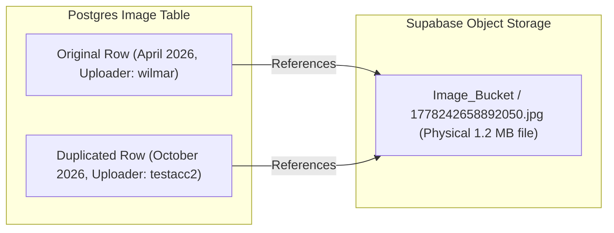
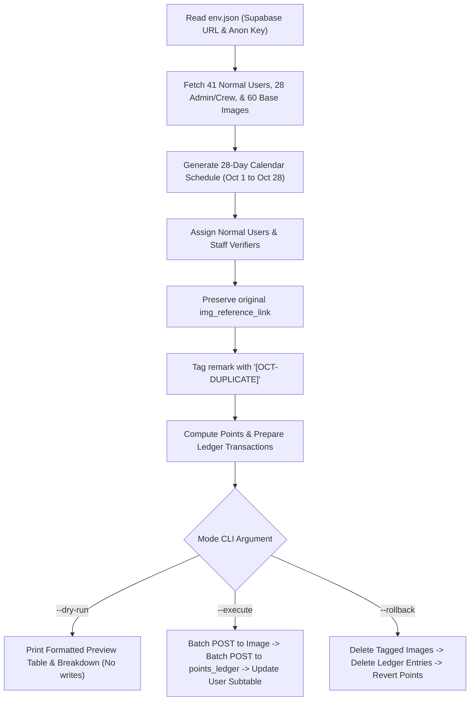

# Supabase October Data Duplication & Zero-Storage Plan (October 1–28, 2026)

## 1. Executive Summary

This document specifies the technical design, architectural strategy, and execution steps for duplicating baseline waste scan records in Supabase across the extended 4-week date window of **October 1 to October 28, 2026** (28 calendar days).

The objective is to establish an active, realistic dataset for academic research evaluation, testing resident leaderboard flows, and street compliance tracking without inflating Supabase Object Storage usage.

### Key Tenets
1. **Zero Storage Consumption**: Reuses existing public image URLs (`img_reference_link`) directly from `Image_Bucket`, consuming **0 additional megabytes** of file storage.
2. **Resident-Only Upload Attribution**: Strictly distributes the 60 duplicated scans among the **41 Normal Users** (`user_type = 'User'`). Admins and Crews are excluded from uploading.
3. **Crew & Admin Verification Allocation**: Verification fields (`admin_id`, `updated_by`) are distributed across the **28 Admin and Crew** accounts to simulate local collection monitoring.
4. **Gamification Full Sync**: Automatically awards points (+10 to +30 pts) in compliance with Phase 9 points rules, populating `points_ledger` and updating `User Subtable` (`user_points`, `spendable_points`).
5. **Reversibility & Audit Safety**: Every duplicated record is tagged with `[OCT-DUPLICATE]`, enabling risk-free `--dry-run` inspection and one-command `--rollback`.

---

## 2. Live Supabase Baseline & Audit

An audit of the production Supabase database (`https://clbgdlxkxvjsvcdnvsri.supabase.co`) was conducted to evaluate existing records:

### 2.1 Table Inventory

| Table | Current Count | Key Notes |
| :--- | :--- | :--- |
| **`User`** | **69 rows** | 41 Normal Users, 18 Admins, 10 Crew members. |
| **`User Subtable`** | **69 rows** | Gamification state (`user_points`, `spendable_points`, `current_streak`, `best_streak`). 13 users currently have points > 0. |
| **`Image`** | **60 rows** | Baseline scans from April 29 to June 13, 2026, plus late October pilot scans. |
| **`points_ledger`** | **0 rows** | Clean slate, ready to record official transaction entries. |
| **`Report`** | **5 rows** | Waste incident reports (April–May 2026). |
| **`Street`** | **4 rows** | `Street N`, `Kalusugan Street`, `Masbate`, `Session Road`. |
| **`street_compliance_snapshot`**| **4 rows** | Weekly compliance metrics per street. |

### 2.2 User Segmentation

```
Total Users (69)
├── Normal Residents (41)  ──>  Assigned as uploaders (img_uploader)
└── Staff / Verifiers (28)
    ├── Admins (18)         ──>  Assigned as verifiers (admin_id, updated_by)
    └── Crews (10)          ──>  Assigned as verifiers (admin_id, updated_by)
```

- **41 Normal Users**: `testacc1`, `testacc2`, `Prince Amorsolo Remo`, `Muralidharan`, `Grace Nillama`, `wilmar`, `mich`, `albert`, `Jerome`, etc.
- **28 Admins & Crews**: `admin1`, `oeubx`, `Aldrin Ibanez`, `Norhana Hadji Ali`, `CruelicyFakeIsNot`, `Richel`, `Gil`, etc.

---

## 3. Zero-Byte Storage Architecture

### 3.1 The Storage Problem vs. Database Sizing
In Supabase, resource quotas are divided into:
- **Supabase Storage (Object Buckets)**: 1 GB free quota. Uploading 60 duplicate physical JPEG/PNG images would waste valuable bucket bandwidth and storage.
- **Supabase Postgres Database (Relational Tables)**: 500 MB free quota. 60 table rows consume approximately **35 Kilobytes** ($< 0.01\%$ of database storage).

### 3.2 The Zero-Byte Soft Referencing Solution
In the `Image` table, image media is stored as a URL string in the `img_reference_link` column:
```
https://clbgdlxkxvjsvcdnvsri.supabase.co/storage/v1/object/public/Image_Bucket/Street%20N/1778242658892050.jpg
```

Instead of duplicating the file in the bucket, new rows in the `Image` table are inserted with:
- A new unique `image_id` (UUIDv4).
- The **exact same** `img_reference_link` pointing to the pre-existing storage object.



**Net impact on Supabase Storage:** **`0.00 MB`**.  
The Flutter client displays both images seamlessly via cached network calls, with no degradation in loading speed or image fidelity.

---

## 4. Date Range & Distribution Model (October 1–28, 2026)

### 4.1 Daily Cadence (28 Days)
- **Time Window**: October 1, 2026 00:00:00 UTC through October 28, 2026 23:59:59 UTC (4 complete calendar weeks).
- **Scan Cadence**:
  $$\frac{60 \text{ scans}}{28 \text{ days}} \approx 2.14 \text{ scans/day}$$
  - **4 Days with 3 Scans**: Assigned to peak weekend pickup days (e.g. Saturdays: Oct 3, Oct 10, Oct 17, Oct 24) to mirror genuine community activity.
  - **24 Days with 2 Scans**: Distributed smoothly across all remaining days.
- **Daytime Dispersion**: Upload timestamps are randomly distributed during realistic resident activity windows: **07:30 AM to 05:30 PM UTC+8**.

### 4.2 Resident Attribution
- The 60 images are assigned across the 41 normal users:
  - **19 Users** receive **2 scans** (scheduled on separate weeks).
  - **22 Users** receive **1 scan**.
  - **100% of normal users** achieve active October participation on the resident feed and leaderboard.
- **Street Consistency**: The duplicated scan's `img_streetNameRef` is aligned to the uploader's registered street in `User.user_streetNameRef` (e.g. `Street N`).

### 4.3 Admin & Crew Verification Attribution
- For scans marked with `verification_status: 'verified'` or `'corrected'`:
  - `admin_id` and `updated_by` are randomly allocated among the **28 Admin and Crew members**.
  - Verification timestamp (`verified_at`, `updated_at`) is set **15 to 90 minutes** after the upload timestamp.

---

## 5. Gamification Full Synchronization (Option 2)

Per EBasura's Phase 9 Points Ledger and Gamification specifications (`test/unit/phase9_points_ledger_test.dart`), verified scans generate points according to standard rules:

### 5.1 Points Scoring Formula
$$\text{Total Points} = \text{Base Verified (10)} + \text{Segregation Bonus (15)} + \text{Recyclable Bonus (5)}$$

| Scan State | Base | Segregated Bonus | Recyclable Bonus | Total Points Awarded |
| :--- | :---: | :---: | :---: | :---: |
| Verified + Segregated + Recyclable | +10 | +15 | +5 | **+30 pts** |
| Verified + Segregated + Non-Recyclable | +10 | +15 | 0 | **+25 pts** |
| Verified + Unsegregated | +10 | 0 | 0 | **+10 pts** |
| Pending / Non-Verified | 0 | 0 | 0 | **0 pts** |

### 5.2 Anti-Gaming Daily Caps
- Maximum **3 point-earning scans** per user per day.
- Maximum **1 segregation bonus (+15 pts)** per user per day.
- Duplicated records will naturally abide by this rule due to the 2–3 scans/day dispersion across 41 users.

### 5.3 Database Updates
For each point-earning scan:
1. **`points_ledger`**: Insert an audit row:
   - `user_id`: Uploader UUID.
   - `points`: Computed points (+10, +25, or +30).
   - `reason_code`: `'OCT_DUPLICATE_SYNC'`.
   - `image_id`: Duplicated scan UUID.
   - `street_ref`: Street name.
   - `created_at`: Verified timestamp.
2. **`User Subtable`**: Atomically increment:
   - `user_points = user_points + award`
   - `spendable_points = spendable_points + award`
   - `updated_at = NOW()`

---

## 6. Safety, Rollback & Isolation Strategy

### 6.1 Audit Tagging
All duplicated records in `Image` will carry an explicit safety marker in the `remark` column:
```
remark: '[OCT-DUPLICATE] <original_remark>'
```
And ledger rows will have:
```
reason_code: 'OCT_DUPLICATE_SYNC'
```

### 6.2 Rollback Safety
Because every created record is explicitly tagged:
- **Original records** have no `[OCT-DUPLICATE]` marker and will never be touched.
- A single `--rollback` execution can instantly find, calculate point deductions, update `User Subtable`, and delete only the duplicated records.

---

## 7. Implementation Script Design

The operation is encapsulated in a standalone script: `scripts/duplicate_october_data.py`.



### 7.1 CLI Commands

```powershell
# 1. Preview changes, user mappings, and date distribution without touching DB
python scripts/duplicate_october_data.py --dry-run

# 2. Execute live duplication and gamification synchronization
python scripts/duplicate_october_data.py --execute

# 3. Emergency rollback (if ever needed to cleanly remove all duplicated data)
python scripts/duplicate_october_data.py --rollback
```

---

## 8. Verification & Acceptance Checklist

### 8.1 Automated Verification
- [ ] Run `--dry-run` to verify that all 60 scans map to October 1–28, 2026.
- [ ] Verify that 100% of uploaders are normal users (`user_type = 'User'`).
- [ ] Verify that 100% of verifiers are Admins or Crews (`user_type IN ('Admin', 'Crew')`).
- [ ] Run `--execute` and verify HTTP 201 Created responses.
- [ ] Query Supabase `Image` table: total count must increase from 60 to 120 rows.
- [ ] Query `points_ledger`: audit transactions recorded with reason `OCT_DUPLICATE_SYNC`.
- [ ] Verify Supabase Object Storage size in dashboard remains at 0 MB added.

### 8.2 Mobile App Manual Verification
- [ ] **Resident Feed**: Verify that October scans appear chronologically in resident feeds.
- [ ] **Image Rendering**: Confirm images load instantly without missing thumbnails or CDN 404s.
- [ ] **Leaderboard**: Check that the resident leaderboard displays the October points earned.
- [ ] **Admin Verification Log**: Confirm that Admin/Crew names are properly reflected on verified items.
