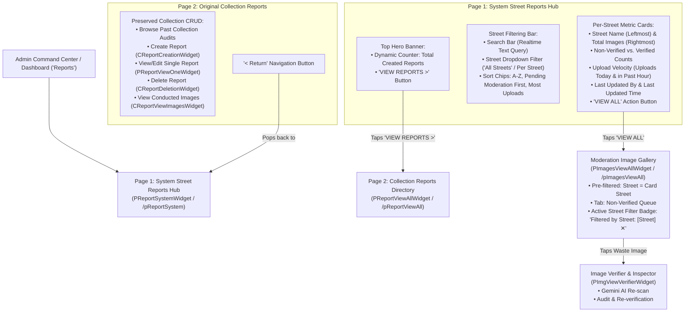

# System Street Reports Hub & Dual-Page Architecture

> **Feature Backlog Reference**: `[EBASURA-M6-F1]` (Reports Directory & Feed) / `[EBASURA-M4-F3]` (Category Filter Hub & Feeds)  
> **Brand & Design System Compliance**: [`docs/EBASURA_BRAND_AND_DESIGN_SYSTEM.md`](../../EBASURA_BRAND_AND_DESIGN_SYSTEM.md)  
> **Target Platforms**: Flutter (Android/iOS) • Supabase Database (`Report`, `Street`, `Image`)  

---

## 1. Overview & Dual-Page Architecture

EBasura implements a **Two-Tier Report Architecture** that separates macro street-level waste analytics and moderation entry points from historical collection incident logging.



---

## 2. Comparison: Old vs. Updated Report Architecture

| Attribute | Old Architecture (`PReportViewAllWidget`) | Updated Dual-Page Architecture (`PReportSystemWidget` + `PReportViewAllWidget`) |
| :--- | :--- | :--- |
| **Primary Route** | `/pReportViewAll` | `/pReportSystem` (System Reports Hub) |
| **Top Hero Section** | Static image banner | **Total Created Reports Counter** + high-contrast **`VIEW REPORTS >`** button |
| **Aggregation Entity** | By individual collection log (`report_id`) | **By Community Street (`street_name`)** cross-referenced with `Image` records |
| **Metrics Displayed** | Historical count on a specific collection date | **Total Images Uploaded**, **Non-Verified Count**, **Verified Count**, **Uploads/day & Uploads/hour rate** |
| **Audit Metadata** | `reporter_userRef` of log creator | **`lastUpdatedBy`** and **`lastUpdatedTime`** (from latest verification/scan) |
| **Drill-Down Action** | View static photo bottom sheet | **`VIEW ALL`** button deep-linking directly into [`PImagesViewAllWidget`](../../../lib/image/image_views/p_images_view_all/p_images_view_all_widget.dart) pre-filtered to that street on the **Non-Verified** tab |
| **Moderation Flow** | Read-only static image grid | Direct re-scanning with Google Gemini REST API and point awarding via [`PImgViewVerifierWidget`](../../../lib/image/image_views/p_img_view_verifier/p_img_view_verifier_widget.dart) |
| **Collection CRUD** | Replaced / isolated | **100% Preserved as Page 2**, reachable via top banner button with reciprocal safe return |

---

## 3. Component Specifications

### 3.1 Page 1: System Street Reports Hub (`PReportSystemWidget`)
- **Location**: `lib/admin/report/p_report_system/`
- **Route**: `/pReportSystem` (`PReportSystemWidget.routeName = 'P_Report_System'`)
- **Key Models & State**: `PReportSystemModel`
  - `searchController` / `searchFocusNode` / `searchQuery`: Live text filter.
  - `selectedStreetFilter`: Dropdown filter selection (`'All'` or specific street name).
  - `sortBy`: Active sorting strategy (`'Alphabetical'`, `'Pending First'`, `'Most Uploads'`).
- **Features & Capabilities**:
  1. **Top Hero Banner**:
     - Left column: Dynamic count of all collection reports in `ReportTable` with loading skeleton state.
     - Right column: **`VIEW REPORTS >`** pill button (Button 2 spec: `#2E78A6` solid with white text).
  2. **Filtering & Sorting Bar**:
     - Real-time search field with instant clear (`✕`) button.
     - Street selection dropdown populated dynamically from `StreetTable`.
     - Horizontal sorting chips (A-Z, Pending Moderation First, Most Uploads).
  3. **Main Street Cards Feed**:
     - Enclosed in a `RefreshIndicator` for pull-to-refresh data reloading.
     - Street Name (Bold `InterTight`, 17px) & Total Images Uploaded pill badge (`#A3C9D9`).
     - Non-Verified Tally Container (Soft Red `#FDE8E8` container, `#C44545` accent).
     - Verified Tally Container (Soft Mint `#D5F2E2` container, `#31A11F` Eco Green accent).
     - Upload Velocity indicator (`~X uploads/day • Peak: Y uploads/hour`).
     - Audit attribution (`Last updated by: [User] (X time ago)`).
     - **`VIEW ALL`** pill button linking to the deep-filtered moderation feed.

---

### 3.2 Deep-Link Contract with `PImagesViewAllWidget`
When an administrator taps **`VIEW ALL`** on a street card, navigation passes route query parameters:
```dart
context.pushNamed(
  PImagesViewAllWidget.routeName,
  queryParameters: {
    'initialTabIndex': serializeParam(0, ParamType.int),
    'initialStatus': serializeParam('Non-Verified', ParamType.String),
    'initialStreet': serializeParam(summary.streetName, ParamType.String),
  }.withoutNulls,
);
```

#### Consumer Implementation in `PImagesViewAllWidget`:
1. **Parameter Acceptance**: `final String? initialStreet;` and `final String? initialStatus;`.
2. **State Initialization**:
   - `_model.selectedStreet = widget.initialStreet!`
   - `_model.selectedTabIndex = 0` (Non-Verified Tab)
   - `_model.activeQuickFilter = 'All'`
3. **Active Street Filter Badge**:
   - Renders a reactive badge above the image grid feed: `Filtered by Street: [Street] ✕`.
   - Tapping `✕` resets `_model.selectedStreet = 'All'` and triggers `_model.resetStream()`.

---

## 4. Aggregation Formulas & Algorithm Specifications

### 4.1 Data Pipeline per Street
```text
Total Images Uploaded = |{img ∈ Images | img.streetName.toLowerCase() == street.streetName.toLowerCase()}|
Verified Images       = |{img ∈ Images | img.streetName.toLowerCase() == street.streetName.toLowerCase() ∧ img.status == 'Verified'}|
Non-Verified Images   = Total Images Uploaded - Verified Images
Uploads Today         = |{img ∈ Images | img.streetName.toLowerCase() == street.streetName.toLowerCase() ∧ img.createdAt ≥ startOfToday}|
Uploads Last Hour     = |{img ∈ Images | img.streetName.toLowerCase() == street.streetName.toLowerCase() ∧ img.createdAt ≥ (now - 1 hour)}|
```

### 4.2 Case-Insensitive Street Deduplication
To prevent duplicate street cards caused by variations in user-input letter casing:
```dart
final Map<String, StreetRow?> streetMap = {};
for (final s in streets) {
  final trimmed = s.streetName.trim();
  if (trimmed.isNotEmpty) {
    streetMap[trimmed] = s;
  }
}
for (final img in images) {
  final name = img.imgStreetNameRef.trim();
  if (name.isNotEmpty &&
      !streetMap.keys.any((k) => k.toLowerCase() == name.toLowerCase())) {
    streetMap[name] = null;
  }
}
```

### 4.3 Audit Metadata Fallback Hierarchy
The `lastUpdatedBy` and `lastUpdatedTime` values are resolved in order of priority:
1. `latestImg.updatedBy` (Admin/Crew who verified or rescanned the image)
2. `streetRow.lastUpdatedBy` (Street boundary manager)
3. `latestImg.imgUploader` (Citizen who submitted the photo)
4. Fallback string: `'No updates yet'`

---

## 5. Automated Verification & Test Suite

Automated regression coverage for the two-tier report system is implemented in:
- **Test File**: [`test/unit/phase6_system_report_test.dart`](../../../test/unit/phase6_system_report_test.dart)
- **Suite Coverage**:
  1. `Street report calculates total, verified, and non-verified image tallies accurately`
  2. `Calculates uploads today and uploads within past hour accurately`
  3. `Resolves lastUpdatedBy and relative timestamp fallback hierarchy properly`
  4. `Sorts correctly by Alphabetical (A-Z)`
  5. `Sorts correctly by Pending Moderation First`
  6. `Sorts correctly by Most Uploads`
  7. `Filters summaries correctly with search query and dropdown selection`

**Verification Command**:
```powershell
flutter test test/unit/phase6_system_report_test.dart
```
