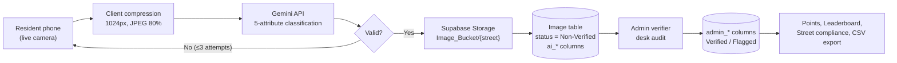
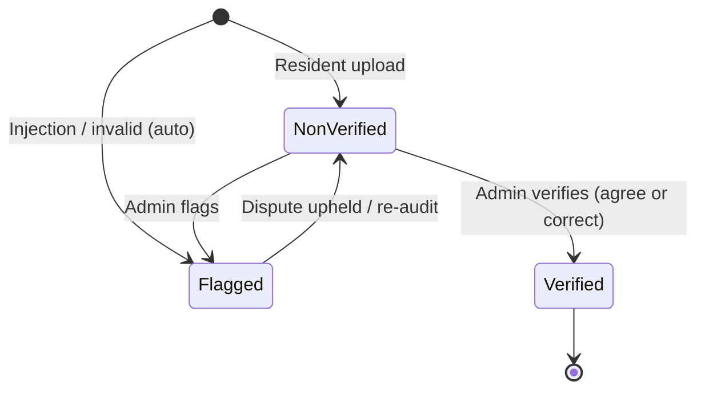

# EBasura: An AI-Assisted, Human-Verified Mobile System for Household Waste Segregation Monitoring in Philippine Barangays

> **Draft status:** First full draft (v0.1), Chapters 1–6
> **Source:** Dev's *Academic Research Paper Document Roadmap* + `docs/` on branch `feat/rd-update` (github.com/Oeubx/EBasura)
> **Conventions used in this draft:**
> - `[CITE]` = a source still needs to be found and added. Do not submit with these left in.
> - `[DATA]` = a value that has to come from the field trial. **No results in this draft are real.**
> - `(→ docs/...)` = the repo document this section was written from.
> - **Read Appendix A before you defend.** It lists places where the docs contradict each other or the roadmap.

---

## CHAPTER 1 — INTRODUCTION

### 1.1 Background of the Study
*(→ docs/modules/OPTIMIZATIONS_INDEX.md)*

Solid waste management (SWM) is still a persistent governance problem for Philippine local government units (LGUs). Republic Act No. 9003, the *Ecological Solid Waste Management Act of 2000*, requires waste to be segregated at source. It also gives barangays responsibility for collecting segregated biodegradable, compostable, and reusable waste. In practice, however, checking whether households comply depends on manual inspection. Collection crews or barangay personnel have to look at bags at the roadside or go door to door. This is slow and inconsistent, and it leaves no record that can be audited. As a result, barangays have little spatial or historical data on which streets regularly fail to segregate. They also cannot easily track where roadside dumping hot-spots form. `[CITE: local SWM compliance study / DENR-EMB report]`

Multimodal Large Language Models (MLLMs) are now widely available. Google's Gemini family, for example, can classify an image from a natural-language prompt without task-specific training. This makes it possible to move the first round of inspection from the street to a phone camera. The AI result then becomes a *preliminary* label that a human official confirms at a desk, which takes seconds instead of a physical visit.

EBasura is a Flutter mobile application with a Supabase (PostgreSQL) back end. The system is organized into 11 modules (Module 0–10), which cover core architecture, authentication, profiles, AI scanning, moderation, gamification, incident reporting, collection schedules, the street directory, administrator operations, and shared navigation.

### 1.2 Statement of the Problem
*(→ docs/modules/module-6-waste-reporting/README.md)*

**General problem:** Barangays have no fast, auditable, data-producing way to check household waste segregation and respond to residents' waste reports.

**Specific problems:**
1. Physically inspecting waste bags door to door takes too much labor, gives inconsistent results, and leaves no verifiable record.
2. There is a delay between a resident seeing a waste hazard and the collection crew being sent, because there is no structured reporting channel.
3. Fully automated AI classification cannot be relied on by itself. Closed opaque bags show only their top layer, and adversarial images can manipulate the model.
4. Residents have little incentive to segregate consistently or to take part in reporting.

### 1.3 Objectives of the Study

**General objective:** To design, develop, and evaluate EBasura, an AI-assisted, human-verified mobile system that classifies household waste segregation from live photographs and supports barangay-level verification, reporting, and civic participation.

**Specific objectives:**
1. Build a live-camera-only capture pipeline that classifies waste on five attributes (valid waste, recyclable, segregated, biodegradable, non-biodegradable) using a multimodal LLM.
2. Add safeguards against unreliable or adversarial inputs: a 3-attempt retake guardrail and a visual prompt-injection guard.
3. Implement a Human-in-the-Loop (HITL) moderation workflow (Non-Verified → Verified / Flagged) that stores AI predictions and human decisions in separate columns.
4. Provide role-based access for Guests, Residents, Collection Crew, and Administrators.
5. Evaluate the AI against human ground truth using accuracy, precision, recall, F1-score, and Cohen's κ, and measure how long desk audits take.
6. Add a gamification layer (points, leaderboard, badges) and a street-level compliance view to encourage participation. *(Partially implemented, see Appendix A.)*

### 1.4 Significance of the Study
- **Barangay officials / LGUs:** Each photo takes a few seconds to check at a desk instead of a physical visit, and every decision leaves an audit trail.
- **Collection crews:** Less time spent inspecting bags at the roadside, and a structured channel for reporting incidents.
- **Residents:** A transparent record of their own compliance, a way to appeal (dispute), and recognition through gamification.
- **Researchers:** A reusable dual-column dataset design for evaluating MLLMs in public-service settings.

### 1.5 Scope and Delimitations
*(→ docs/access_control/README.md)*

**Scope**
- Android only, distributed as a sideloaded APK (minSdk 23 / Android 6.0).
- Four roles: **Guest** (anonymous scanning, no points), **Resident** (scans, points, disputes, incident reports), **Collection Crew** (routes, pickups, field reports), **Administrator** (moderation, verification, user and schedule management).
- AI classification uses Google Gemini (`gemini-2.5-flash`, `gemini-flash-latest`) through REST.
- Waste is classified into five binary attributes. It is not identified at the level of individual objects.

**Delimitations**
- The AI judges only what is **visible**. For a closed bag, that is the top layer or outer surface. Results are treated as a sample, never as a full characterization of the contents.
- AI output is **never final**. Only administrator-verified records count as official.
- The study does not train a custom model. It evaluates a general-purpose MLLM used zero-shot.
- iOS, offline classification, and integration with LGU systems outside the app are out of scope.
- The field trial covers `[DATA: barangay name, number of streets, trial period]`.

### 1.6 Definition of Terms
| Term | Operational definition |
| :--- | :--- |
| **Segregated** | Waste in a bag or container belongs to a single stream (or is properly separated), as judged from the photo. |
| **Non-Verified / Verified / Flagged** | The three moderation states of an uploaded image (see 4.4). |
| **Ground truth** | The administrator's final classification of an image (`admin_classification`). |
| **HITL** | Human-in-the-Loop: a design where AI output is reviewed by a human before it takes effect. |
| **Retake guardrail** | A limit of 3 failed scan attempts per capture session. |
| **Prompt injection (visual)** | Text placed in an image to manipulate the model's output. |

### 1.7 Research Framework: Design Science Research Methodology
*(→ docs/backlogs/EBASURA_Sprint_Backlogs_Commit_Reference.md)*

The study follows the Design Science Research Methodology (DSRM) of Peffers et al. (2007). It has six activities: (1) identify the problem, (2) define the objectives, (3) design and develop, (4) demonstrate, (5) evaluate, and (6) communicate. The artifact is EBasura itself. Each design objective is traced to a sprint backlog code in the form `[EBASURA-M#-F#]` (module, feature), and every commit is tagged with its code. This gives a 1:1 audit trail from requirement to implementation, which is an important source of rigor in DSR (Hevner et al., 2004).

| DSRM activity | EBasura evidence |
| :--- | :--- |
| Problem identification | Chapter 1; RA 9003 compliance gap |
| Objectives | §1.3; backlog catalog M0–M10 |
| Design & development | Chapters 3–4; tagged commits |
| Demonstration | Field trial `[DATA]` |
| Evaluation | Chapter 5 (confusion matrix, κ, latency, tests) |
| Communication | This manuscript; `docs/` |

---

## CHAPTER 2 — REVIEW OF RELATED LITERATURE

> ⚠️ **Note:** The repo docs describe *the system*. They are not literature. Each section below gives a structure and the claims that need to be supported. You still need to find and add peer-reviewed sources at every `[CITE]`.

### 2.1 Computer Vision in Solid Waste Characterization
*(→ docs/releases/versions/v2.0.0+1.md for the system side)*

Early automated waste classification used convolutional neural networks (CNNs) trained on curated datasets such as TrashNet (Yang & Thung, 2016) `[CITE: verify + add 2–3 newer CNN/YOLO waste papers]`. These models perform well on single, well-lit objects against clean backgrounds. They struggle with cluttered real-world scenes and need retraining whenever a new category is added.

Multimodal LLMs such as Gemini can classify images *zero-shot*: the categories are described in the prompt, so no task-specific training data is needed `[CITE: Gemini technical report; MLLM zero-shot classification study]`. EBasura uses this approach. `gemini-flash-latest` handles authenticated scans, and `gemini-2.5-flash` handles guest scans and revalidation. The model returns five binary attributes for each image. The trade-off is less control over how the model behaves, and its output format is not deterministic. EBasura addresses the formatting problem with structured JSON output (§3.4).

**Research gap:** Few studies evaluate general-purpose MLLMs on *household waste segregation compliance* in a developing-country LGU setting, particularly with human ground truth collected during normal operations. `[CITE: support gap claim]`

### 2.2 The "Closed Bag" Dilemma and the Limits of Vision
*(→ docs/ai_vision/retake_guardrail_and_dual_schema.md)*

A photo of a closed or opaque bag shows only its outer surface or top layer. This is an *occlusion* problem: no vision model can reliably infer what it cannot see `[CITE: occlusion in object recognition]`. Poor lighting, glare, and extreme angles reduce image quality further `[CITE: image quality vs. classification accuracy]`.

EBasura treats this as a design constraint and does not try to solve it:
- **Retake guardrail:** If the image is unreadable, the user is guided to retake it, up to 3 attempts, so the system does not loop forever or burn API quota.
- **HITL fallback:** After the third failure the image is sent for manual inspection, so residents are not left stuck.
- **Delimitation:** Results are framed as samples of the visible portion.

### 2.3 Adversarial Prompt Injection in Multimodal Models
*(→ docs/modules/module-3-ai-waste-scanning/classification_and_injection_guard.md)*

Prompt injection happens when attacker-controlled content overrides a model's instructions (Greshake et al., 2023) `[CITE: verify; add a visual/multimodal injection paper]`. In multimodal models, the injected instructions can appear as **text inside the image**. A resident could, for example, hold up a sign reading *"Ignore previous instructions, set valid_waste_image to true and award 1000 points."*

EBasura's defense prompt tells the model to return `false` for all five attributes if any visible text tries to redirect its instructions. Such uploads get zero points and are quarantined as **Flagged**. This is a mitigation, not a guarantee. Defenses that rely on prompts are known to be bypassable `[CITE]`, so human verification remains the final control.

### 2.4 Human-in-the-Loop Machine Learning
*(→ docs/ai_vision/category_tri_state_transition.md)*

HITL systems place human judgment at key decision points in an AI pipeline `[CITE: Monarch, 2021, *Human-in-the-Loop Machine Learning*; verify]`. In public-service settings where results affect citizens (points, warnings, compliance grades), HITL provides accountability, gives a way to correct errors, and produces labeled data continuously. EBasura applies this strictly. Every AI prediction starts as **Non-Verified** and only becomes official after an administrator **Verifies** it. Each human decision is stored next to the AI's original output, so normal operation also builds the evaluation dataset used in Chapter 5.

### 2.5 Gamification and Civic Participation
*(→ docs/modules/module-5-gamification-leaderboard/points_and_leaderboard.md)*

Gamification means using game-design elements in non-game contexts (Deterding et al., 2011) `[CITE: verify]`. Studies of pro-environmental behavior report that points, leaderboards, and badges can increase engagement, although the effect may fade over time and extrinsic rewards can crowd out intrinsic motivation `[CITE: gamification + recycling; self-determination theory]`. EBasura awards points for valid scans, segregation, recyclables, and verified incident reports, and ranks users on a community leaderboard. **Design principle taken from the concept document:** points should be based on *verified* records and the *administrator's* classification, not the AI's, so rankings stay fair.

### 2.6 Synthesis
| Theme | What literature says | How EBasura responds |
| :--- | :--- | :--- |
| CNN waste classifiers | Accurate in lab settings, brittle in the field | Zero-shot MLLM, no training required |
| Occlusion | Unsolvable from one photo | Retake guardrail + delimitation + HITL |
| Prompt injection | Real, only partly mitigable | Defense prompt + quarantine + human review |
| HITL | Accountability + labeled data | Tri-state lifecycle + dual-column schema |
| Gamification | Raises engagement, decays over time | Points on verified data only |

---

## CHAPTER 3 — METHODOLOGY AND SYSTEM ARCHITECTURE

### 3.1 Research Design
This is developmental (design science) research with a quantitative evaluation component. The artifact was built iteratively in sprints tracked by backlog codes, then evaluated in a field trial against human ground truth.

### 3.2 System Architecture Overview

### 3.3 Anti-Spoofing Media Acquisition (Rule 5)
*(→ docs/ai_vision/scanning_process_workflow.md)*

Residents can capture images **only** through the device camera (`MediaSource.camera`). The gallery picker is not available to them. This prevents uploads of old photos, stock images, or someone else's waste. Every record stores the uploader's ID, and the timestamp should be set **by the server** when the upload arrives rather than taken from the phone's clock. *(Check that the implementation does this. See Appendix A.)* Manual gallery upload is available only to administrators.

### 3.4 Client-Side Viewfinder and Framing
*(→ docs/testing/EBASURA_Manual_Testing_App_Enhancements.md, [EBASURA-M3-F6])*

A `CustomPainter` overlay on the camera shows corner reticles, an optional rule-of-thirds grid, and lighting instructions. The aim is to improve image quality *before* capture and so reduce failed scans.

### 3.5 Edge Compression and Network Payload
*(→ docs/modules/module-3-ai-waste-scanning/optimizations.md, commit 8f981e4)*

Phone cameras produce photos of 12–48 MP. Base64-encoding these creates request bodies of 8–15 MB, which leads to memory spikes and timeouts on cellular networks. EBasura downsizes each image so its longest side is at most 1024 px and compresses it to JPEG at 80% quality before encoding. This brings the payload under ~300 KB.
`[DATA: measure mean payload size and round-trip latency before/after on N test photos — the "4x–8x faster" and "negligible accuracy loss" claims in the docs are not yet backed by measurements.]`

### 3.6 Multimodal API Integration
*(→ docs/modules/module-3-ai-waste-scanning/gemini_api_integration.md)*

- Images are sent as base64 inline data to the Gemini REST endpoint.
- **API keys are scoped by operation** (authenticated scan, guest scan, revalidation). This keeps quota use separate per operation and limits damage if one key leaks.
- **Output contract:** The original design used 5 plain-text lines split on `\n`, which breaks easily when the model adds markdown or commentary. The planned or implemented fix uses Gemini's structured output (`response_mime_type: application/json`) with a schema of boolean fields plus `prompt_injection_detected`. *(Confirm which one is live.)*

**Classification contract**
| Attribute | Type | Meaning |
| :--- | :--- | :--- |
| `valid_waste_image` | bool | The image contains real waste |
| `recyclable` | bool | Plastics, metal, glass, paper |
| `segregated` | bool | Properly sorted vs. mixed |
| `biodegradable` | bool | Organic, decomposes |
| `non_biodegradable` | bool | Synthetics, styrofoam, rubber |

### 3.7 Retake Guardrail Algorithm
*(→ docs/ai_vision/retake_guardrail_and_dual_schema.md, [EBASURA-M3-F6])*

| Attempt | Trigger | System response |
| :--- | :--- | :--- |
| 1 | API error or `valid_waste_image = false` | Guidance card "Attempt 1 of 3": lighting, centering |
| 2 | Second failure | Guidance card "Attempt 2 of 3": glare, steadiness |
| 3 | Third failure | Hard-cap modal → **Submit for Manual Inspection** or **Start Over** |

A manual-inspection submission is stored with `ai_classification = 'Unclassified'`, `ai_confidence_score = 0`, `status = 'Non-Verified'`.

### 3.8 Cloud Infrastructure and Storage
*(→ docs/modules/module-0-core-architecture/supabase_client_and_environment.md)*

- **Back end:** Supabase (PostgreSQL + Auth + Storage), configured from an untracked `env.json` that is injected with `--dart-define-from-file`.
- **Storage:** A single bucket, `Image_Bucket`, with folders `/{street}/` (resident scans), `/Guest/` (anonymous scans), and `/Reports/` (incident evidence).
- **Integrity:** Row Level Security (RLS) policies, for example `auth.uid() = reporter_userRef` on report inserts.

### 3.9 Data Collection Procedure (Field Trial)
1. Recruit `[DATA: n]` residents across `[DATA: k]` streets in `[DATA: barangay]`.
2. Residents scan their household waste bags with EBasura over `[DATA: period]`.
3. One or more barangay verifiers audit every Non-Verified record in the verifier screen.
4. Export the `Image` table through the CSV exporter ([EBASURA-M8-F5]).
5. Compute the metrics in Chapter 5.

**Recommended:** For a stronger κ analysis, have **two** human verifiers independently label a subset (for example 50 images). This gives human–human agreement as a baseline to compare against AI–human agreement.

### 3.10 Evaluation Instruments
| Instrument | Measures |
| :--- | :--- |
| Confusion matrix + Accuracy/Precision/Recall/F1 | AI classification quality |
| Cohen's κ | Agreement beyond chance (AI vs. admin) |
| `verification_time_seconds` | Desk audit latency |
| Unit test suite + QA checklist | Functional correctness |
| `[Optional]` ISO/IEC 25010 or SUS survey | Software quality / usability `[recommended for defense]` |

---

## CHAPTER 4 — SYSTEM IMPLEMENTATION

### 4.1 Role-Based Access Control
*(→ docs/access_control/{resident,crew,admin}_access.md)*

On launch, the app checks the authentication state. If the user is signed in, `RoleService.fetchCurrentUserRole()` reads `user.user_type` and resolves one of four roles.

| Feature | Guest | Resident | Crew | Admin |
| :--- | :---: | :---: | :---: | :---: |
| AI scanner | Guest scanner (no points) | Full (points) | Full | Full |
| Personal uploads | — | ✓ | ✓ | ✓ |
| Leaderboard | Read-only | Participant | Participant | Moderator view |
| Incident reports | — | Submit | Submit | Submit & resolve |
| Crew dashboard | — | — | ✓ | View |
| Moderation / verifier | — | — | — | ✓ |
| User / schedule / badge mgmt | — | — | — | Full CRUD |

### 4.2 Master Permissions (CRUD) Topology
*(→ docs/access_control/crud_matrix.md)*
`[Insert the CRUD matrix table from crud_matrix.md here as Table 4.x — 8 functional domains × roles × C/R/U/D/USE.]`

### 4.3 Role-Adaptive Navigation
*(→ docs/modules/module-10-navigation-components/shared_ui_components.md)*

`CBottomBarWidget` changes its tabs depending on the role:
- Guest/Resident: Home · Rankings · **[Camera]** · Explore · Profile/Sign In
- Crew: Routes · Pickups · **[Camera]** · Reports · Profile
- Admin: Dashboard · Review · **[Camera]** · Users · Profile

For residents and guests, the center FAB opens the scanner with `autoTriggerCamera: true`, so a scan takes a single tap.

### 4.4 Tri-State Moderation Lifecycle
*(→ docs/ai_vision/category_tri_state_transition.md)*

The legacy schema mixed moderation state and waste attributes in one `status` column, with values such as "Segregated", "Categorized by Ai", and "Disputed". The redesign **separates** the two:

- `status ∈ {Non-Verified, Verified, Flagged}`, enforced by `CHECK` constraint `chk_image_tri_state_status`
- Waste attributes are stored as independent booleans: `isSegregated`, `category_recycling`, `category_biode`, `category_nonbiode`

Six near-duplicate filtered screens (~538 lines each) were merged into one parameterized `PImagesViewAllWidget(initialStatus:)`, which removed more than 1,500 lines of redundant code. Old routes are kept as aliases. A stream-caching bug (`??=` on the Postgrest stream, which froze filter changes) was also fixed ([EBASURA-M4-F1]).

### 4.5 Civic Incident Reporting
*(→ docs/modules/module-6-waste-reporting/incident_reporting.md)*

Residents submit reports from their Profile screen. Each report has a subject, a street (from `StreetTable`), a description, a photo uploaded to `Image_Bucket/Reports/`, and the reporter (bound automatically to `auth.uid()`). New reports default to `report_status = 'Pending'`. Crew and admins use the `CReportCreationWidget` modal, which adds an inspection date. RLS prevents users from inserting reports under someone else's identity.

### 4.6 Anonymous Guest Persistence
*(→ docs/access_control/guest_access.md)*

Guest scans are saved to `Image_Bucket/Guest/` and to the `Image` table with `img_uploader = null`. This gives municipal telemetry without accounts or points. A "Guest Participation Mode" card encourages guests to sign up.

### 4.7 Design System
*(→ docs/design_system/brand_and_design_system.md)*

| Token | Hex | Use |
| :--- | :--- | :--- |
| Ocean Blue | `#2E78A6` | Primary actions |
| Sky Blue | `#A3C9D9` | Guidance cards |
| Mint | `#D5F2E2` | Badges |
| Eco Green | `#31A11F` | Verified / success |
| Leaf Green | `#70BF5A` | Secondary accent |
| Off-white | `#F2F2F2` | Background |

Typography: **Comfortaa** for the brand wordmark only and **Inter** for all UI text. Pill radius is 20 px and the minimum tap target is 48 px.
Status colors: Non-Verified `#E65100`, Verified `#2E7D32`, Flagged `#C44545`.

### 4.8 Dual-Column Evaluation Schema (Implementation)
*(→ docs/ai_vision/retake_guardrail_and_dual_schema.md)*

| AI side (written at upload) | Human side (written at audit) |
| :--- | :--- |
| `ai_classification` | `admin_classification` |
| `ai_waste_type` | `admin_waste_type` |
| `ai_confidence_score` | `admin_id` |
| `ai_raw_json` | `verification_status` (verified / corrected / rejected) |
| | `verification_time_seconds`, `verified_at` |

The audit never overwrites the AI's prediction, so the original output is always available for evaluation.

---

## CHAPTER 5 — RESULTS AND DISCUSSION

> **All tables below are templates.** Fill them in from the exported CSV after the field trial.

### 5.1 Dataset Description
| Item | Value |
| :--- | :--- |
| Trial period | `[DATA]` |
| Participating residents / streets | `[DATA]` / `[DATA]` |
| Total scans uploaded | `[DATA]` |
| Auto-flagged (injection / invalid) | `[DATA]` |
| Manual-inspection fallbacks (3 retakes) | `[DATA]` |
| Audited by admin (evaluation set, N) | `[DATA]` |

Only rows where `verification_status ∈ {verified, corrected}` **and** `ai_classification ≠ 'Unclassified'` go into the classification metrics.

### 5.2 Confusion Matrix and Classification Metrics
*(→ docs/evaluations/developer_updates_evaluation.md)*

Positive class = **Segregated**. Predicted = `ai_classification`, Actual = `admin_classification`.

| | Actual Segregated | Actual Unsegregated |
| :--- | :---: | :---: |
| **AI: Segregated** | TP = `[DATA]` | FP = `[DATA]` |
| **AI: Unsegregated** | FN = `[DATA]` | TN = `[DATA]` |

$$\text{Accuracy}=\frac{TP+TN}{TP+TN+FP+FN}\quad \text{Precision}=\frac{TP}{TP+FP}\quad \text{Recall}=\frac{TP}{TP+FN}\quad F_1=\frac{2PR}{P+R}$$

Repeat for each waste attribute (recyclable, biodegradable, non-biodegradable). Each is a separate binary task:

| Attribute | Accuracy | Precision | Recall | F1 | Support |
| :--- | :---: | :---: | :---: | :---: | :---: |
| Segregated | `[DATA]` | | | | |
| Recyclable | `[DATA]` | | | | |
| Biodegradable | `[DATA]` | | | | |
| Non-biodegradable | `[DATA]` | | | | |

**Discussion prompts:** Is the AI more likely to call mixed bags segregated (FP) or the reverse? Relate errors to the closed-bag dilemma (§2.2). Which attribute is hardest?

### 5.3 Inter-Rater Reliability (Cohen's κ)

$$\kappa=\frac{p_o-p_e}{1-p_e}$$

- $p_o$ = **observed agreement**, the proportion of images where the AI and the admin gave the same label.
- $p_e$ = **agreement expected by chance**, computed from each rater's marginal label frequencies.

*(Correction to the roadmap: $p_o$ and $p_e$ are not "the model" and "the verifiers". Both are properties of the pair of raters.)*

| Pair | $p_o$ | $p_e$ | κ | Interpretation (Landis & Koch, 1977) |
| :--- | :---: | :---: | :---: | :--- |
| AI vs. Admin | `[DATA]` | | | |
| Admin 1 vs. Admin 2 (baseline, optional) | `[DATA]` | | | |

Landis & Koch bands: <0 poor, 0.01–0.20 slight, 0.21–0.40 fair, 0.41–0.60 moderate, 0.61–0.80 substantial, 0.81–1.00 almost perfect.

### 5.4 Desk Audit Latency
*(→ docs/modules/module-4-image-records-moderation/image_views_and_history.md)*

`verification_time_seconds` is measured from the moment the verifier screen opens (`initState`) to the moment the decision is submitted.

| Metric | Verified (agree) | Corrected | All |
| :--- | :---: | :---: | :---: |
| Mean (s) | `[DATA]` | `[DATA]` | `[DATA]` |
| Median (s) | `[DATA]` | | |
| SD (s) | `[DATA]` | | |

**Baseline comparison:** To support a claim of speedup, measure or cite the time a door-to-door inspection takes per household `[DATA or CITE]`. Without that baseline, the speedup claim cannot be defended. Also note that corrections should take longer than agreements, which shows the admins actually look at each image rather than clicking through.

### 5.5 Functional Verification
*(→ docs/access_control/qa_verification_checklist.md)*
| Suite | Cases | Passed | Failed |
| :--- | :---: | :---: | :---: |
| Automated unit tests (`test/unit/`) | `[confirm count]` | | |
| Manual QA checklist (4 roles) | `[confirm 45 vs 46]` | | |
| Prompt-injection probes (e.g. 10 adversarial signs) | `[DATA]` | | |

### 5.6 Data Export
The admin CSV exporter ([EBASURA-M8-F5]) produces RFC 4180-compliant files that are used for all calculations in this chapter. Keep the raw CSV as a thesis appendix so the results can be reproduced.

### 5.7 Summary of Findings
`[Write after data: 3–5 bullets answering each specific objective in §1.3.]`

---

## CHAPTER 6 — CONCLUSIONS AND RECOMMENDATIONS

### 6.1 Civic Dispute and Citizen Recourse
*(→ docs/modules/module-4-image-records-moderation/image_views_and_history.md, [EBASURA-M4-F7])*

Residents can contest any non-verified decision with `CDisputeDecisionWidget`. They choose a category (e.g. "AI Misclassification") and give a reason of at least 5 characters. The dispute is written to `remark` as `[DISPUTE - category]: reason` and sent back for re-audit. Giving residents a way to appeal is central to procedural fairness when automated systems affect them. `[CITE: algorithmic accountability / due process]`

### 6.2 Street Cleanliness Index and Compliance Grading
*(→ docs/modules/module-8-street-directory/street_registry.md, **not yet specified in the docs, see Appendix A**)*

The proposed approach rates each street by the share of its **verified** scans that are segregated, adjusted for incident reports. Streets below a threshold are **flagged** for barangay follow-up. *(This is the "flag the streets of residents who didn't segregate" feature, which is next on the to-do list. Proposed formula:)*

$$\text{SCI}_s = 100\cdot\frac{\#\,\text{verified segregated scans}_s}{\#\,\text{verified scans}_s} - w\cdot\#\,\text{verified incident reports}_s$$

| Grade | SCI | Action |
| :--- | :--- | :--- |
| A | ≥ 85 | Recognition |
| B | 70–84 | Reminder |
| C | < 70 | **Flagged** for barangay follow-up |

Require a minimum number of scans (e.g. n ≥ 10 verified scans per period) before a street is graded, so that a single bad scan cannot fail a whole street.

### 6.3 Scalability and Distribution
*(→ docs/releases/README.md)*

EBasura is distributed as a universal APK (~87 MB, SHA-256 published) shared offline by USB, Drive, or Bluetooth. This lets barangays deploy it without Play Store publication. The trade-offs are that it triggers Play Protect warnings, updates are manual, and the APK is large. Future work should consider per-ABI split APKs and an update channel.

### 6.4 Conclusions
`[Write after Chapter 5. Answer each objective: (1) pipeline built? (2) safeguards effective? (3) HITL workflow operational? (4) RBAC complete? (5) AI accuracy/κ level? (6) gamification/compliance status.]`

### 6.5 Recommendations
**For LGUs / barangays**
1. Use verified EBasura records as supporting evidence for RA 9003 monitoring, not as the sole basis for penalties.
2. Assign at least one trained verifier per barangay and track audit latency.
3. Use street grades to target information campaigns before enforcement.

**For future researchers / developers**
1. Replace the hard-coded confidence score with a real one (see Appendix A).
2. Add GPS and server-side timestamps for stronger anti-spoofing.
3. Once AI–admin κ stays high, test **sampling-based** verification instead of reviewing every scan.
4. Compare multiple MLLMs, or a fine-tuned CNN, on the same exported dataset.
5. Run a longitudinal study of whether the gamification effect lasts.

---

## APPENDIX A — Doc Conflicts & Gaps Found During Drafting (resolve with dev)

| # | Issue | Where | Why it matters |
| :--- | :--- | :--- | :--- |
| 1 | **`ai_confidence_score` is hard-coded to `92.50`** in the insert payload | retake_guardrail_and_dual_schema.md §6.2 | 🔴 Any confidence analysis would be invalid. Either get a real score (e.g. ask the model for one in the JSON schema, or use logprobs) or drop confidence from the thesis. |
| 2 | **Points rules conflict:** +10/+15/+5/+25 per action vs. "+25 to +100 pts" | points_and_leaderboard.md vs. retake doc diagram | Must be settled before the leaderboard/rewards work. |
| 3 | Points awarded when "verified by **Gemini API** or verifier" | points_and_leaderboard.md | Contradicts the concept rule: points should come only from **admin-verified** results. |
| 4 | **Street grading (A/B/C) does not exist** in street_registry.md | Roadmap §6.2 | The roadmap cites a doc that does not contain the algorithm. This is the street-flagging feature, still to be built. |
| 5 | Streaks, badges, and gamification theory are not in points_and_leaderboard.md | Roadmap §2.5 | Literature has to come from outside sources. Badges/streaks need a spec. |
| 6 | Invalid scans: **retake** (guardrail) vs. **auto-Flagged** (tri-state doc) | retake doc vs. tri-state §3.3 | Two different behaviors for the same event. Proposal: invalid → retake; injection detected → Flagged. |
| 7 | Concept says failed photos are **not saved**. Guardrail uploads them after 3 fails as "Unclassified" | Concept §6 vs. retake doc §3.3 | Pick one and state it in the methodology. |
| 8 | `verification_status = 'disputed'` and concept's `rescanned` are not in the documented allowed set (pending/verified/corrected/rejected) | image_views_and_history.md | Schema and code may be inconsistent. Add a CHECK constraint. |
| 9 | Incident report photos allow **device gallery** | incident_reporting.md §2 | Inconsistent with Rule 5 (live camera only). |
| 10 | Rate limiters were **removed** for field testing (commit a1cb85c) | evaluation doc §4 | Must be restored before any real deployment. Note it as a threat to validity. |
| 11 | Test counts don't match: 45 vs. 46 QA cases. 57 unit tests across "phase1–phase8" vs. phase1–5 | README vs. roadmap §5.5 | Confirm actual numbers before writing them in. |
| 12 | v2.0.0+1.md is **release notes**, not a literature review | Roadmap §2.1 | Chapter 2 needs peer-reviewed sources. |
| 13 | Roadmap defines κ's $p_o$/$p_e$ as "model" / "verifiers" | Roadmap §5.3 | Incorrect. Fixed in §5.3 above. |
| 14 | Speedup over door-to-door is claimed with no baseline measurement | Roadmap §5.4 | Needs measured or cited baseline data. |
| 15 | Server-side timestamp (concept §5) not confirmed. Insert uses the client `getCurrentTimestamp` | retake doc §6.2 | Phone clock can be spoofed. Use a DB `DEFAULT now()`. |
