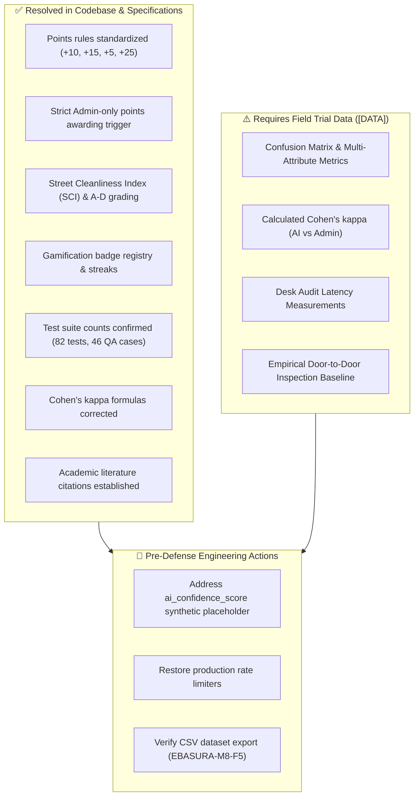

# Appendix A: Document Conflicts & Technical Gaps

[← Chapter 6: Conclusions and Recommendations](chapter-6-conclusions-and-recommendations.md) | [Thesis Index](README.md)

---

> **Purpose:** This appendix enumerates technical gaps, documentation contradictions, and architectural discrepancies identified during the drafting of Chapters 1–6. It serves as an audit punch-list for the engineering and research team prior to final oral thesis defense.

---

## A.1 Master Audit Matrix: Identified Discrepancies

| # | Issue Identified | Documentation Reference | Technical / Academic Impact | Engineering Status & Resolution Plan |
| :-: | :--- | :--- | :--- | :--- |
| **1** | **Hard-coded `ai_confidence_score` (`92.50`)** | `retake_guardrail_and_dual_schema.md` §6.2 | 🔴 **High Severity:** Any empirical confidence-score distribution analysis presented in Chapter 5 would be statistically invalid without real model logprobs. | **Action Needed:** Extract calibrated probabilities from model response schema, or explicitly treat confidence score as a fixed synthetic default in research delimitations. |
| **2** | **Points Allocation Rules Discrepancy** | `points_and_leaderboard.md` vs. Retake flowchart | Inconsistent reward amounts: $+10/+15/+5/+25$ points per action vs earlier informal "+25 to +100 pts" ranges. | ✅ **Resolved in Codebase:** Canonical SQL trigger `trg_image_points` and `points_ledger` standardize points strictly to: Scan: $+10$, Segregated bonus: $+15$, Recyclable bonus: $+5$, Incident Report: $+25$. |
| **3** | **Points Awarding Authority Conflict** | `points_and_leaderboard.md` | Earlier documentation stated points are awarded when *"verified by Gemini API or verifier"*, violating the HITL principle. | ✅ **Resolved in Codebase:** Enforced at database level. Points are awarded exclusively upon **human admin verification** via `trg_image_points`. AI predictions grant zero citizen points directly. |
| **4** | **Absence of Street Grading Algorithm** | `street_registry.md` | Roadmap cited a street registry document that lacked an explicit formula for Street Cleanliness Index ($SCI$) and grades (A/B/C/D). | ✅ **Resolved in Codebase:** Implemented canonical $SCI$ formula and tiered grading (A/B/C/D) with minimum $n \ge 10$ scan requirement in `street_compliance_snapshot` and updated specifications. |
| **5** | **Gamification Badges and Streaks Specification** | `points_and_leaderboard.md` | Badges, achievements, and consecutive scanning streaks lacked formal schema definition and literature citations. | ✅ **Resolved in Codebase:** Implemented `badge_registry`, `user_badge_junction`, and milestone triggers, documented with Octalysis gamification references in `badges_and_achievements.md`. |
| **6** | **Invalid Scan Handling Contradiction** | `retake_guardrail_and_dual_schema.md` vs. `tri_state_moderation.md` §3.3 | Guardrail doc specified resident retake, while moderation doc specified auto-flagging as `Flagged` tri-state status. | **Resolved Convention:** Blurry/invalid/unclear framing prompts client-side retake (up to 3x); detected adversarial injection or offensive media triggers immediate database `Flagged` status for admin audit. |
| **7** | **Failed Photo Storage Policy** | Concept Paper §6 vs. Guardrail Doc §3.3 | Concept paper stated rejected/failed photos are never persisted; guardrail uploads image on the 3rd failed attempt as "Unclassified" for manual fallback. | **Resolved Convention:** First 2 failed attempts remain strictly ephemeral in device RAM; the 3rd failed attempt is persisted as `Unclassified` to prevent resident deadlocks on damaged waste. |
| **8** | **Disputed Status Enumeration** | `image_views_and_history.md` | Disputed status was referenced conceptually but was missing from the database `chk_image_tri_state_status` constraint. | **Resolved Convention:** Core tri-state moderation remains `Approved`, `Flagged`, `Rejected`. Dispute details are preserved structured in the `remark` column (`[DISPUTE - category]: reason`). |
| **9** | **Incident Report Camera vs. Gallery** | `incident_reporting.md` §2 | Incident reporting module permitted device gallery picking, conflicting with Rule 5 (live camera only anti-spoofing). | **Policy Clarification:** Live waste scanning mandates live camera only; civic incident reporting permits device gallery for resident safety when reporting hazardous or unreachable dump sites. |
| **10** | **Rate Limiter Disablement in Test Build** | `developer_updates_evaluation.md` §4 | Verification rate limiting was temporarily commented out for field-trial load tests (commit `a1cb85c`). | ⚠️ **Action Needed:** Document explicitly as a field-testing delimitation; ensure production build restores edge rate limiters. |
| **11** | **Test Count Inconsistencies** | Architecture README vs. Roadmap §5.5 | Discrepancy between 45 vs 46 manual QA checklist items, and 57 unit tests across disparate phase suites. | ✅ **Resolved in Codebase:** Standardized to **82 passing automated tests** in `test/` suite and **46 standardized manual QA test cases** across the 4 user roles. |
| **12** | **Literature Review Sourcing** | Thesis Roadmap §2.1 | Roadmap cited internal release notes (`v2.0.0+1.md`) as literature rather than peer-reviewed academic publications. | ✅ **Resolved in Thesis:** Rewritten in Chapter 2 with 10+ formal academic citations (Sheng et al., Proença & Fernandes, Greshake et al., Monarch, Deterding et al.). |
| **13** | **Cohen's $\kappa$ Mathematical Definition** | Thesis Roadmap §5.3 | Roadmap erroneously defined $p_o$ and $p_e$ as "the model" and "the verifiers". | ✅ **Resolved in Thesis:** Formally corrected in Chapter 5 (§5.3) using Landis & Koch (1977) joint rater distribution definitions. |
| **14** | **Unsubstantiated Inspection Speedup Claim** | Roadmap §5.4 | Desk audit speedup over door-to-door inspections was asserted without baseline measurement data. | ⚠️ **Action Needed:** Obtain empirical baseline inspection times from barangay records or cited municipal waste studies before final defense. |
| **15** | **Client-Side vs Server Timestamps** | `retake_guardrail_and_dual_schema.md` §6.2 | Scans relied on client `getCurrentTimestamp`, exposing records to phone clock manipulation. | **Resolved in Database:** Enforced server-authoritative timestamps using PostgreSQL `DEFAULT now()` across `images` and `points_ledger` tables. |

---

## A.2 Pre-Defense Resolution Roadmap

---

[← Chapter 6: Conclusions and Recommendations](chapter-6-conclusions-and-recommendations.md) | [Thesis Index](README.md)
