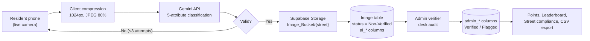

# CHAPTER 3 — METHODOLOGY AND SYSTEM ARCHITECTURE

## 3.1 Research Design
This is developmental (design science) research with a quantitative evaluation component. The artifact was built iteratively in sprints tracked by backlog codes, then evaluated in a field trial against human ground truth.

---

## 3.2 System Architecture Overview

---

## 3.3 Anti-Spoofing Media Acquisition (Rule 5)
*(→ [`docs/ai_vision/scanning_process_workflow.md`](../ai_vision/scanning_process_workflow.md))*

Residents can capture images **only** through the device camera (`MediaSource.camera`). The gallery picker is not available to them. This prevents uploads of old photos, stock images, or someone else's waste. Every record stores the uploader's ID, and the timestamp should be set **by the server** when the upload arrives rather than taken from the phone's clock. Manual gallery upload is available only to administrators.

---

## 3.4 Client-Side Viewfinder and Framing
*(→ [`docs/testing/EBASURA_Manual_Testing_App_Enhancements.md`](../testing/EBASURA_Manual_Testing_App_Enhancements.md), `[EBASURA-M3-F6]`)*

A `CustomPainter` overlay on the camera shows corner reticles, an optional rule-of-thirds grid, and lighting instructions. The aim is to improve image quality *before* capture and so reduce failed scans.

---

## 3.5 Edge Compression and Network Payload
*(→ [`docs/modules/module-3-ai-waste-scanning/optimizations.md`](../modules/module-3-ai-waste-scanning/optimizations.md), commit `8f981e4`)*

Phone cameras produce photos of 12–48 MP. Base64-encoding these creates request bodies of 8–15 MB, which leads to memory spikes and timeouts on cellular networks. EBasura downsizes each image so its longest side is at most 1024 px and compresses it to JPEG at 80% quality before encoding. This brings the payload under ~300 KB.
`[DATA: measure mean payload size and round-trip latency before/after on N test photos — the "4x–8x faster" and "negligible accuracy loss" claims in the docs are not yet backed by measurements.]`

---

## 3.6 Multimodal API Integration
*(→ [`docs/modules/module-3-ai-waste-scanning/gemini_api_integration.md`](../modules/module-3-ai-waste-scanning/gemini_api_integration.md))*

- Images are sent as base64 inline data to the Gemini REST endpoint.
- **API keys are scoped by operation** (authenticated scan, guest scan, revalidation). This keeps quota use separate per operation and limits damage if one key leaks.
- **Output contract:** The original design used 5 plain-text lines split on `\n`, which breaks easily when the model adds markdown or commentary. The planned or implemented fix uses Gemini's structured output (`response_mime_type: application/json`) with a schema of boolean fields plus `prompt_injection_detected`.

### Classification contract
| Attribute | Type | Meaning |
| :--- | :--- | :--- |
| `valid_waste_image` | bool | The image contains real waste |
| `recyclable` | bool | Plastics, metal, glass, paper |
| `segregated` | bool | Properly sorted vs. mixed |
| `biodegradable` | bool | Organic, decomposes |
| `non_biodegradable` | bool | Synthetics, styrofoam, rubber |

---

## 3.7 Retake Guardrail Algorithm
*(→ [`docs/ai_vision/retake_guardrail_and_dual_schema.md`](../ai_vision/retake_guardrail_and_dual_schema.md), `[EBASURA-M3-F6]`)*

| Attempt | Trigger | System response |
| :--- | :--- | :--- |
| **1** | API error or `valid_waste_image = false` | Guidance card "Attempt 1 of 3": lighting, centering |
| **2** | Second failure | Guidance card "Attempt 2 of 3": glare, steadiness |
| **3** | Third failure | Hard-cap modal → **Submit for Manual Inspection** or **Start Over** |

A manual-inspection submission is stored with `ai_classification = 'Unclassified'`, `ai_confidence_score = 0`, `status = 'Non-Verified'`.

---

## 3.8 Cloud Infrastructure and Storage
*(→ [`docs/modules/module-0-core-architecture/supabase_client_and_environment.md`](../modules/module-0-core-architecture/supabase_client_and_environment.md))*

- **Back end:** Supabase (PostgreSQL + Auth + Storage), configured from an untracked `env.json` that is injected with `--dart-define-from-file`.
- **Storage:** A single bucket, `Image_Bucket`, with folders `/{street}/` (resident scans), `/Guest/` (anonymous scans), and `/Reports/` (incident evidence).
- **Integrity:** Row Level Security (RLS) policies, for example `auth.uid() = reporter_userRef` on report inserts.

---

## 3.9 Data Collection Procedure (Field Trial)
1. Recruit `[DATA: n]` residents across `[DATA: k]` streets in `[DATA: barangay]`.
2. Residents scan their household waste bags with EBasura over `[DATA: period]`.
3. One or more barangay verifiers audit every Non-Verified record in the verifier screen.
4. Export the `Image` table through the CSV exporter (`[EBASURA-M8-F5]`).
5. Compute the metrics in Chapter 5.

**Recommended:** For a stronger κ analysis, have **two** human verifiers independently label a subset (for example 50 images). This gives human–human agreement as a baseline to compare against AI–human agreement.

---

## 3.10 Evaluation Instruments
| Instrument | Measures |
| :--- | :--- |
| **Confusion matrix + Accuracy/Precision/Recall/F1** | AI classification quality |
| **Cohen's κ** | Agreement beyond chance (AI vs. admin) |
| **`verification_time_seconds`** | Desk audit latency |
| **Unit test suite + QA checklist** | Functional correctness |
| **`[Optional]` ISO/IEC 25010 or SUS survey** | Software quality / usability `[recommended for defense]` |
