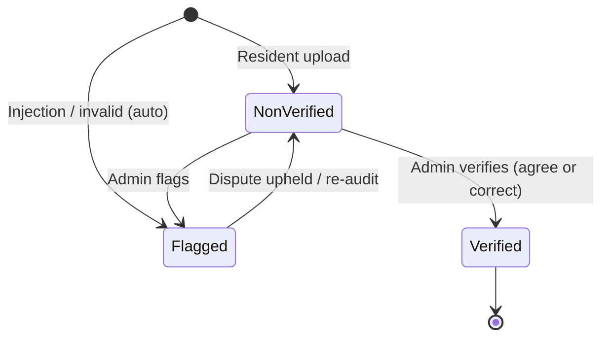

# CHAPTER 4 — SYSTEM IMPLEMENTATION

## 4.1 Role-Based Access Control
*(→ [`docs/access_control/resident_access.md`](../access_control/resident_access.md), [`crew_access.md`](../access_control/crew_access.md), [`admin_access.md`](../access_control/admin_access.md))*

On launch, the app checks the authentication state. If the user is signed in, `RoleService.fetchCurrentUserRole()` reads `user.user_type` and resolves one of four roles.

| Feature | Guest | Resident | Crew | Admin |
| :--- | :---: | :---: | :---: | :---: |
| **AI scanner** | Guest scanner (no points) | Full (points) | Full | Full |
| **Personal uploads** | — | ✓ | ✓ | ✓ |
| **Leaderboard** | Read-only | Participant | Participant | Moderator view |
| **Incident reports** | — | Submit | Submit | Submit & resolve |
| **Crew dashboard** | — | — | ✓ | View |
| **Moderation / verifier** | — | — | — | ✓ |
| **User / schedule / badge mgmt** | — | — | — | Full CRUD |

---

## 4.2 Master Permissions (CRUD) Topology
*(→ [`docs/access_control/crud_matrix.md`](../access_control/crud_matrix.md))*

The master permissions matrix establishes explicit boundaries across 8 functional domains, enforcing Human-in-the-Loop oversight and preventing privilege escalation:
- **AI Scanning & Images:** Residents upload live photos to `Image_Bucket/{street}/` with initial `status = 'Non-Verified'`; administrators review and verify.
- **Incident Reporting:** Residents and crew file waste complaints; only administrators can transition reports through resolution.
- **Collection Schedules:** Publicly readable by residents and guests; administrators execute full CRUD; crew toggles live route checklists.
- **Points & Leaderboard:** Points ledger is immutable and trigger-enforced; residents configure visibility modes (`full_name`, `initials`, `anonymous`).
- **Street Compliance:** Publicly readable snapshot scores; administrators manage the intervention flag desk and trigger recomputation.

---

## 4.3 Role-Adaptive Navigation
*(→ [`docs/modules/module-10-navigation-components/shared_ui_components.md`](../modules/module-10-navigation-components/shared_ui_components.md))*

`CBottomBarWidget` changes its tabs depending on the role:
- **Guest / Resident:** Home · Rankings · **[Camera]** · Explore · Profile/Sign In
- **Crew:** Routes · Pickups · **[Camera]** · Reports · Profile
- **Admin:** Dashboard · Review · **[Camera]** · Users · Profile

For residents and guests, the center Floating Action Button (FAB) opens the scanner with `autoTriggerCamera: true`, so an environmental scan takes a single tap.

---

## 4.4 Tri-State Moderation Lifecycle
*(→ [`docs/ai_vision/category_tri_state_transition.md`](../ai_vision/category_tri_state_transition.md))*

The legacy schema mixed moderation state and waste attributes in one `status` column, with values such as "Segregated", "Categorized by Ai", and "Disputed". The redesign **separates** the two:

- `status ∈ {Non-Verified, Verified, Flagged}`, enforced by `CHECK` constraint `chk_image_tri_state_status`
- Waste attributes are stored as independent booleans: `isSegregated`, `category_recycling`, `category_biode`, `category_nonbiode`

Six near-duplicate filtered screens (~538 lines each) were merged into one parameterized `PImagesViewAllWidget(initialStatus:)`, which removed more than 1,500 lines of redundant code. Old routes are kept as aliases. A stream-caching bug (`??=` on the Postgrest stream, which froze filter changes) was also fixed (`[EBASURA-M4-F1]`).

---

## 4.5 Civic Incident Reporting
*(→ [`docs/modules/module-6-waste-reporting/incident_reporting.md`](../modules/module-6-waste-reporting/incident_reporting.md))*

Residents submit reports from their Profile screen. Each report has a subject, a street (from `StreetTable`), a description, a photo uploaded to `Image_Bucket/Reports/`, and the reporter (bound automatically to `auth.uid()`). New reports default to `report_status = 'Pending'`. Crew and admins use the `CReportCreationWidget` modal, which adds an inspection date. RLS prevents users from inserting reports under someone else's identity.

---

## 4.6 Anonymous Guest Persistence
*(→ [`docs/access_control/guest_access.md`](../access_control/guest_access.md))*

Guest scans are saved to `Image_Bucket/Guest/` and to the `Image` table with `img_uploader = null`. This gives municipal telemetry without accounts or points. A "Guest Participation Mode" card encourages guests to sign up.

---

## 4.7 Design System
*(→ [`docs/design_system/brand_and_design_system.md`](../design_system/brand_and_design_system.md))*

| Token | Hex | Use |
| :--- | :--- | :--- |
| **Ocean Blue** | `#2E78A6` | Primary actions |
| **Sky Blue** | `#A3C9D9` | Guidance cards |
| **Mint** | `#D5F2E2` | Badges |
| **Eco Green** | `#31A11F` | Verified / success |
| **Leaf Green** | `#70BF5A` | Secondary accent |
| **Off-white** | `#F2F2F2` | Background |

Typography: **Comfortaa** for the brand wordmark only and **Inter** for all UI text. Pill radius is 20 px and the minimum tap target is 48 px.
Status colors: Non-Verified `#E65100`, Verified `#2E7D32`, Flagged `#C44545`.

---

## 4.8 Dual-Column Evaluation Schema (Implementation)
*(→ [`docs/ai_vision/retake_guardrail_and_dual_schema.md`](../ai_vision/retake_guardrail_and_dual_schema.md))*

| AI side (written at upload) | Human side (written at audit) |
| :--- | :--- |
| `ai_classification` | `admin_classification` |
| `ai_waste_type` | `admin_waste_type` |
| `ai_confidence_score` | `admin_id` |
| `ai_raw_json` | `verification_status` (verified / corrected / rejected) |
| | `verification_time_seconds`, `verified_at` |

The audit never overwrites the AI's prediction, so the original output is always preserved for academic research and model evaluation.
